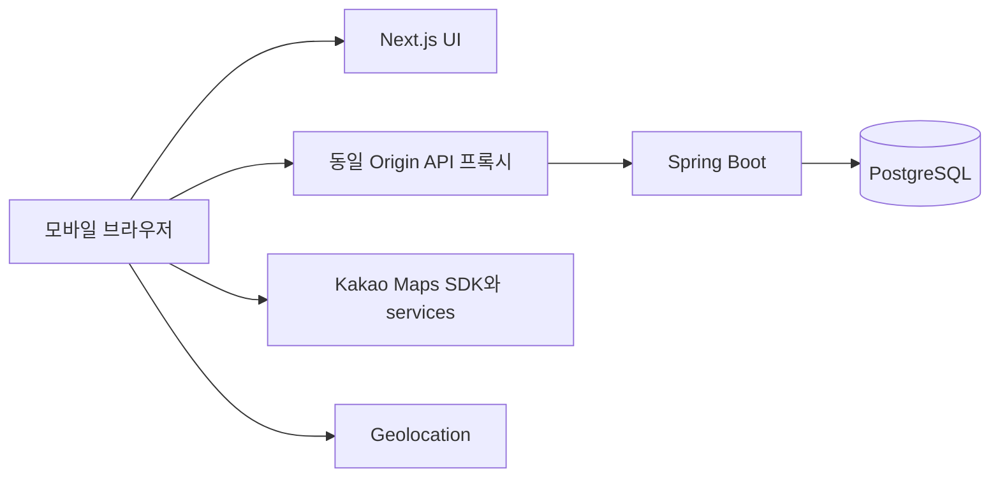

# 소비 위치 기록 지도 기반 가계부 아키텍처

> 현재 상태 안내(2026-09-23): 이 문서의 승인 계약은 유지합니다. Windows 미실행·예정·당시 상태 문구는 작성 시점의 이력이며, 현재 구현/검증 상태와 누락은 [자체 점검](self-review.md)을 따릅니다. 핵심 구현은 있으나 개발·검증 미완료이며 배포만 남은 상태가 아닙니다.

## 1. 기준과 결정 상태

기준은 requirements.md와 change-log.md CHG-001이다. 9개 승인 기본값을 유지한다. Windows에서는 문서 작업만 수행한다. 아래 명령과 구성은 구현 단계의 계약이며 실행한 결과가 아니다.

개인 사용자당 10,000건을 성능 측정 기준으로 삼는다. 데이터 저장의 상한은 아니다. Frontend와 Backend를 분리하고 하나의 Spring Boot 애플리케이션과 PostgreSQL을 사용한다. MSA, Redis, 메시지 큐, Kubernetes, PostGIS는 도입하지 않는다.

요구사항의 두 충돌은 CHG-002에 기록한다. 위치 오차 경고는 승인된 1,000m 초과로 해석한다. FR-003의 통신 실패 중 쿠키 제거 및 서버 무효화는 보장할 수 없으므로 개인 화면과 자동 갱신을 차단하고 재시도한다. 서버 확인 후 완료 처리하는 예외 규칙은 CHG-003으로 승인되어 requirements.md에 반영되었다.

## 2. 시스템과 책임

브라우저는 상대 경로 /api/v1을 사용한다. 개발에서는 Next.js rewrite, 운영에서는 TLS reverse proxy가 /api를 Backend로 전달한다. 원래 Origin, 쿠키와 복수 Set-Cookie를 보존한다. Next.js는 비즈니스 DB 접근이나 별도 인증 판정을 담당하지 않는다. SSR에는 개인 거래를 포함하지 않고 인증 후 클라이언트에서 조회한다. 모든 개인 응답은 Cache-Control: no-store다.

Backend는 인증, 소유권, 검증, 저장, 집계의 최종 책임자다. Controller는 DTO 변환, Service는 업무 및 Transaction, Repository는 사용자 범위 질의를 맡는다. 소유 데이터 조회는 findByIdAndUserId 방식으로 제한한다. 없는 ID와 다른 사용자 ID는 모두 404다.

## 3. 모듈과 화면

예정 저장소 구조는 backend/, frontend/, 문서 5개, docker-compose.yml이다. Java 기본 패키지는 com.moneymap이며 auth, user, category, transaction, place, map, statistics, common으로 구분한다. 각 기능 안에 api, application, domain, infrastructure를 둔다. 거래 클래스는 금융 거래임을 명시하는 LedgerTransaction, DB는 transactions, API는 transactions로 고정한다.

Frontend는 app/, features/auth, transactions, categories, location, map, statistics, settings, shared/api, shared/ui로 나눈다. TanStack Query는 서버 상태, React Hook Form과 Zod는 폼, React Context는 인증 상태, 지도 컨트롤러는 중심·level·선택 Marker를 관리한다. TypeScript strict를 적용한다. SDK는 MapAdapter 인터페이스 뒤에 격리하고 동적 로딩한다.

| Route | 화면 및 주요 컴포넌트 | 데이터 |
|---|---|---|
| /login, /signup | LoginForm, SignupForm | auth API |
| / | MonthlySummary, RecentTransactions | summary, transactions |
| /transactions/new | TransactionForm, LocationPicker | categories, 거래 POST |
| /transactions | TransactionFilters, TransactionList | 거래 GET |
| /transactions/[id], /transactions/[id]/edit | TransactionDetail, TransactionForm | 거래 GET/PUT/DELETE |
| /map | MapCanvas, MapFilters, MarkerSheet, AccessibleResultList | map API |
| /statistics | Summary, CategoryChart, PlaceRanking, RegionRanking, MonthlyComparison | statistics API |
| /settings, /settings/categories | ProfileForm, CategoryManager, DeleteAccountDialog | users/me, categories |

하단 내비게이션은 홈, 내역, 등록, 지도, 통계다. 등록은 단일 폼이며 유형·금액·카테고리·날짜만 필수다. 기본 유형은 EXPENSE, 날짜는 서버가 사용자 시간대로 제공하는 today다. 위치 선택은 폼 위의 Sheet에서 수행하며 폼을 unmount하지 않는다. 필터와 지도 위치는 세션 메모리에 보관하고 상세 왕복 때 복원한다. 좌표를 URL이나 localStorage에 보관하지 않는다.

Loading은 Skeleton, Empty는 0 및 등록/필터 초기화 행동, Error는 재시도를 표시한다. 저장 실패 시 입력을 유지한다. MarkerSheet는 dialog 레이블, 포커스 이동 및 복원, Escape 닫기를 지원한다. 터치 대상은 44px 이상, 360~1440px에서 가로 스크롤이 없어야 한다. 지도 드래그 외에 키보드 중심 이동·확정 버튼과 결과 목록을 제공한다. 지도 키가 없거나 SDK가 실패하면 위치 없음 경로를 유지한다.

## 4. 인증과 보안

Access Token은 5분 HS256 JWT로 sub=user UUID, sid=auth_sessions UUID, iss=money-map, aud=money-map-api, iat, exp를 포함한다. 최소 256bit 서명 키는 환경변수로 주입한다. Refresh Token은 32바이트 난수이며 유효기간 14일, 가족의 절대 만료도 로그인부터 14일이다. DB에는 SHA-256 해시만 저장한다.

쿠키 이름은 mm_access, mm_refresh다. 둘 다 HttpOnly, Secure, SameSite=Lax, host-only, Path=/api/v1이다. 운영에서 Secure 해제는 금지한다. 로컬 http://localhost만 개발 프로필에서 Secure=false를 허용한다. 실제 모바일 LAN 접속은 HTTPS가 필요하다. 토큰은 JSON 응답이나 로그에 포함하지 않는다.

모든 보호 요청은 JWT 검증 후 auth_sessions의 만료·revoked_at 및 사용자 존재를 확인한다. DB 조회를 생략하는 토큰 캐시는 두지 않는다. 이 상태 확인으로 성공한 로그아웃의 Access Token도 즉시 무효화한다. DB 장애는 인증 우회가 아니라 503이다.

Refresh는 세션 행을 잠그고 활성 토큰을 소비 처리한 뒤 다음 해시를 삽입한다. 이전 소비 토큰의 재사용은 해당 세션 가족 전체를 폐기한다. 프런트는 Web Locks가 가능한 브라우저에서 갱신을 직렬화하고, 갱신 실패 시 자동 반복 대신 재로그인한다. 회전 응답 유실이나 다중 탭 충돌은 보안상 재로그인이 필요할 수 있다. 보호 요청 401 중 ACCESS_EXPIRED에만 한 번 refresh하고 같은 요청을 재전송한다.

로그아웃은 access가 만료되어도 refresh로 세션을 찾아 폐기하며 쿠키를 같은 Path로 Max-Age=0으로 지운다. 네트워크 실패 때 UI 개인 캐시를 비우고 logoutPending을 유지해 자동 갱신 및 개인 화면을 차단하고 재시도를 제공한다. 서버 폐기가 확인되기 전 성공 메시지를 표시하지 않는다. 완전 오프라인에서는 HttpOnly 쿠키 삭제 및 서버 폐기를 보장하지 못한다.

CSRF는 Spring Security CookieCsrfTokenRepository 기반으로 XSRF-TOKEN 쿠키와 X-XSRF-TOKEN 헤더를 사용한다. CSRF 쿠키만 JS 읽기를 허용하며 Path=/, SameSite=Lax, 운영 Secure다. /auth/csrf로 발급하고 가입·로그인·갱신·로그아웃·탈퇴를 포함한 모든 변경 요청에 적용한다. 인증 전환 뒤 다시 발급한다. Origin 허용 목록도 검증하고 쿠키 값만 비교하는 임의 구현을 만들지 않는다. CORS는 APP_ORIGIN 정확 일치와 credentials만 허용한다. wildcard를 금지한다.

비밀번호는 Argon2id(m=19456 KiB, t=2, p=1)로 해시하고 배포 장비에서 지연을 검증한다. 요구사항의 10~64자와 영문·숫자 포함 규칙을 유지한다. 로그인 실패는 동일 메시지다. 가입 IP당 10회/시간, 로그인 IP당 30회/분 및 정규화 이메일당 실패 5회/15분, refresh 세션당 30회/분으로 시작한다. 단일 프로세스의 제한된 크기 메모리 카운터를 사용하며 재시작 시 초기화되는 한계와 다중 인스턴스 미지원은 기록한다. 429에는 Retry-After를 제공한다.

로그는 requestId, 경로 템플릿, 상태, durationMs, 오류 코드만 기본 기록한다. request body, query string, Cookie, Authorization, 위치·주소·이메일은 기록하지 않는다. HTTP 접근 로그도 query를 제외한다. SDK 오류 보고에는 코드만 포함한다. 외부 지도 요청에 좌표가 전달됨을 위치 선택 UI에서 알린다. CSP는 실제 SDK가 사용하는 origin을 맥북 검증에서 수집해 제한한다. 임의 HTML 삽입은 금지한다.

## 5. 거래와 데이터 일관성

금액 입력·응답은 정수 문자열이다. Backend는 개별 금액 Long, SUM은 BigDecimal(scale=0), Frontend는 표시용 문자열과 필요한 경우 BigInt를 사용한다. 10,000건 최대 합계는 JS 안전 정수 범위를 넘으므로 Number 합산을 금지한다. 잔액과 차액만 음수 문자열을 허용한다.

거래일 LocalDate는 재해석 없이 저장한다. 사용자 시간대는 기본 날짜 및 현재 월을 계산할 때 사용하며 기존 거래일을 이동시키지 않는다. 명시적 from/to 날짜는 양끝 포함이다. 생성·수정은 UTC Instant다.

거래 POST는 클라이언트가 작업당 생성한 Idempotency-Key UUID를 필수로 받는다. 사용자 행 잠금 후 키 조회, 카테고리/장소 검증, 거래·위치·키 기록을 같은 Transaction으로 처리한다. 동일 키와 동일 정규화 본문은 기존 거래를 반환하고 다른 본문은 409다. 거래 삭제 후 키는 삭제된 거래 ID만 유지하고 재등록을 차단한다. 키 기록에는 원본 본문·위치를 남기지 않는다. 계정 탈퇴 시 키도 제거한다.

PUT/DELETE는 If-Match 버전을 요구한다. 조건부 변경에 실패하면 412를 반환한다. 사용자 소유 변경은 사용자 행을 먼저 잠가 탈퇴와의 경합을 직렬화한다. 목록 페이지는 users.data_revision을 포함한 서명 커서다. 거래·카테고리·설정 변경 시 revision을 증가시켜 다음 페이지가 오래되면 409 CURSOR_STALE을 반환하고 처음부터 재조회한다. 각 목록 및 복수 집계 SQL은 동일 repeatable-read 읽기 Transaction으로 실행한다.

기본 카테고리는 가입 시 사용자에게 복사한다. 기본 명칭은 requirements.md BR-006 목록을 채택하고 아이콘은 type별 고정 enum으로 지정한다. 사용자 정의 카테고리는 이름 변경과 보관을 허용한다. 보관 시 이름을 동결하고 기존 거래 편집에서 해당 카테고리를 그대로 유지할 수 있으나 새로 지정할 수 없다.

## 6. 지도와 장소 및 통계

Kakao SDK는 libraries=services,clusterer와 autoload=false로 한 번 로드한다. 브라우저에서 Places.keywordSearch, Geocoder.coord2Address와 coord2RegionCode를 사용한다. 서비스 검색은 300ms debounce와 요청 순번으로 늦은 응답을 폐기한다. 현재 위치는 getCurrentPosition만 사용하며 timeout=10000, maximumAge=0, enableHighAccuracy=true다. accuracy>1000이면 명시적 확인을 요구한다.

검색·주소 해석은 Backend 검색 프록시 없이 브라우저에서 수행한다. 서버는 이를 사용자 제공 스냅샷으로 검증하며 외부 서비스가 보증한 사실로 취급하지 않는다. 별도 서버용 Kakao Secret은 필요 없다. 서비스 실패 시 좌표 저장을 허용하고 지역은 UNKNOWN으로 둔다.

지역은 coord2RegionCode의 법정동 B 결과 code 앞 5자리와 region_1depth_name, region_2depth_name을 시군구 스냅샷으로 쓴다. 집계 키는 11절의 정규 지역 사전으로 통일한다. NAME 키를 별도 순위로 만들지 않는다. 국내 이외 및 빈 주소는 UNKNOWN이다. 경계 판정은 반환된 한 결과만 사용한다. 행정구역 변동에 따른 과거 스냅샷은 자동 정정하지 않는다.

Place는 사용자별 (provider, external_id) 식별 정보만 보유한다. 과거 이름·주소·좌표는 transaction_locations에 남긴다. 검색 ID가 없는 선택은 place_id=null이며 자동 병합하지 않는다. 지도에서는 장소 ID별 또는 수동 좌표 쌍별로 화면 표현만 묶는다. 수동 좌표의 시각적 묶음은 장소 동일성 판정이 아니다. 동일 장소의 기준 좌표와 제목은 필터 안 최신 거래 스냅샷을 쓴다.

지도 질의는 먼저 user, EXPENSE, 기간, 카테고리, 좌표 BBox로 거래를 제한하고 그 안에서 묶는다. 위도 BETWEEN, 경도는 west<=east이면 BETWEEN, 날짜 변경선을 넘으면 lon>=west OR lon<=east다. 가까운 Marker의 Cluster는 Frontend 책임이다. level은 Kakao 기준 1~14이며 큰 값이 더 넓은 영역이다. 결과 상한은 level 1~5:500, 6~9:300, 10~14:200개다. cap+1개를 조회해 초과 여부를 판단한다. 초과하면 임의 부분 Marker를 표시하지 않고 items=[]와 정확한 전체 영역 합계, requiresNarrowing=true를 반환해 확대 또는 필터 축소를 안내한다.

일반 지도 합계는 viewportExpenseTotal, periodExpenseTotal을 구분한다. Bottom Sheet 상세에도 동일 필터·BBox·revision을 전달하여 Marker와 상세 합계가 일치한다. 위치 없는 거래는 periodExpenseTotal에 포함되고 viewport에는 포함되지 않는다.

통계 summary는 전체 거래, categories는 지출 전체, regions는 위치 있는 지출과 UNKNOWN, places는 place_id 있는 지출만 순위에 포함한다. places 응답은 제외된 직접 선택 위치와 위치 없음의 건수·합계를 별도 표시한다. 비율 분모는 각 차원의 대상 합계이며 정수 HALF_UP 반올림으로 비율 합계가 100과 다를 수 있다. 금액 합계는 항상 정확하다. 월 비교는 두 달 카테고리 키 합집합과 지역 키 합집합을 사용하고 이전값 0은 growthPercent=null, status=NOT_COMPARABLE이다. 지역 변화 상위 10개는 차액 절대값 내림차순 및 key 오름차순으로 정한다.

## 7. 실행 및 환경변수 계약

Compose 서비스 db는 PostgreSQL 17, pgdata 볼륨, 내부 5432와 healthcheck pg_isready를 가진다. 전체 실행 프로필 app은 backend:8080, frontend:3000을 추가한다. db healthy -> backend Flyway 완료 및 ready -> frontend 순서다. DB는 기본 127.0.0.1 바인딩, 운영에서는 host port 미공개다. API의 health live는 프로세스, ready는 DB 연결 및 Migration 성공을 확인한다. 상세 health는 비공개다.

맥북에서 사전 샌드박스 승인 후의 예정 명령: docker compose up -d db, backend에서 ./gradlew bootRun, frontend에서 npm ci와 npm run dev. 컨테이너 통합 경로는 docker compose --profile app up --build다. Gradle Wrapper와 npm lockfile을 저장하며 정확 패치 버전은 구현 시 호환성 확인 후 고정한다. 개발 DB를 테스트에 재사용하지 않는다. JPA ddl-auto=validate이며 Flyway 실패 시 시작을 실패 처리한다. 포트 충돌은 아래 환경변수를 바꾸고 origin·프록시·Kakao 도메인을 함께 맞춘다.

| 환경변수 | 기본값/필수 | 공개 | 소비자 |
|---|---|---|---|
| APP_ORIGIN | http://localhost:3000; 운영 HTTPS 필수 | 가능 | Backend CORS/Origin |
| FRONTEND_PORT | 3000 | 가능 | Next/Compose |
| BACKEND_PORT | 8080 | 가능 | Spring/Compose |
| DB_PORT | 5432 | 가능 | Compose host |
| POSTGRES_DB | money_map | 가능 | db |
| POSTGRES_USER | money_map | 서버 설정 | db |
| POSTGRES_PASSWORD | 필수, 기본 없음 | Secret | db |
| SPRING_DATASOURCE_URL | host는 jdbc:postgresql://localhost:5432/money_map, 컨테이너는 db:5432 | 서버 설정 | Backend |
| SPRING_DATASOURCE_USERNAME | POSTGRES_USER와 동일 | 서버 설정 | Backend |
| SPRING_DATASOURCE_PASSWORD | POSTGRES_PASSWORD와 동일 | Secret | Backend |
| JWT_SECRET | 필수, 최소 32바이트 난수 Base64 | Secret | Backend |
| CURSOR_SECRET | 필수, 별도 32바이트 난수 Base64 | Secret | Backend |
| AUTH_COOKIE_SECURE | 운영 true, localhost 개발 false | 가능 | Backend |
| SPRING_PROFILES_ACTIVE | local 또는 prod | 가능 | Backend |
| BACKEND_INTERNAL_URL | http://localhost:8080 또는 http://backend:8080 | 서버 전용 | Next rewrite |
| NEXT_PUBLIC_KAKAO_MAP_APP_KEY | 빈 값 허용 | 브라우저 공개키 | Frontend build |

.env는 Git 제외, .env.example에는 placeholder만 둔다. 필수 Secret 누락은 값 출력 없이 시작 오류로 처리한다. NEXT_PUBLIC 값 변경은 다시 빌드해야 한다. Kakao 키 미설정은 지도/검색만 unavailable로 만들고 나머지 기능은 정상 실행한다.

운영 배포는 단일 호스트 TLS proxy + 세 컨테이너를 기준으로 설계한다. 호스트·도메인·인증서 발급은 미지정이며 실제 배포 전 사용자 준비다. 백업은 암호화해 최대 30일 보관한다. 탈퇴와 복원용 삭제 기록의 원자성 및 복원 개방 조건은 11절을 따른다.

## 8. 테스트 전략

JUnit 5는 순수 계산·날짜·정규화, Repository는 Testcontainers PostgreSQL 17+Flyway, Controller는 MockMvc, 전체 서비스는 SpringBootTest로 검증한다. 프런트는 Vitest, React Testing Library, MSW, Playwright를 선택한다. 외부 SDK는 MapAdapter fake, Geolocation은 success/denied/timeout/low-accuracy fixture를 사용한다. 실제 Kakao 통합과 iOS 권한은 맥북에서 수동 검증한다.

테스트 ID는 TC-FR-001-01 형식이며 오류 사례는 같은 FR의 다음 번호다. NFR은 TC-NFR-001-01로 대응한다. 2명 사용자 데이터로 모든 객체 ID 교환, 토큰 재사용, CSRF, 로그 마스킹을 검사한다. 최대 금액 10,000건 합계, 날짜 변경선 BBox, 좌표 경계, 동일 장소의 다른 스냅샷, 미분류, 위치 null, 페이지 중간 수정, 중복 POST, 탈퇴 중 거래 쓰기, refresh 동시 호출을 포함한다.

성능은 맥북 CPU/RAM/브라우저와 컨테이너 자원을 기록하고 2명 x 10,000건, 동시 사용자 10명, 1분 워밍업 후 5분 측정한다. 일반 p95 500ms, 지도/통계 p95 1000ms, LCP 2.5초, SDK 이후 지도 조작 3초 및 500개 표시 2초 목표를 적용한다. 실제 기기 또는 명시적 Fast 4G 에뮬레이션 조건을 기록한다. N+1은 쿼리 수와 EXPLAIN으로 확인한다. 현재 결과는 전부 미검증이다.

## 9. 요구사항 추적

| ID | 설계/API | 데이터 |
|---|---|---|
| FR-001 | 가입 /auth/signup | users, categories |
| FR-002 | 로그인 /auth/login | auth_sessions, refresh_tokens |
| FR-003 | 로그아웃 /auth/logout, 실패 재시도 | auth_sessions |
| FR-004 | SecurityFilter 및 모든 소유권 조회 | user_id, 복합 FK |
| FR-005 | POST /transactions, 멱등성 | transactions, operation_keys |
| FR-006 | GET /transactions, revision 커서 | transactions, users |
| FR-007 | GET /transactions/{id} | transactions, transaction_locations |
| FR-008 | PUT /transactions/{id}, If-Match | version |
| FR-009 | DELETE /transactions/{id} | 하드 삭제 |
| FR-010 | GET /categories | categories |
| FR-011 | POST/PATCH /categories | categories |
| FR-012 | location=null | 위치 행 없음 |
| FR-013 | Geolocation, 거래 쓰기 | accuracy_m, captured_at |
| FR-014 | SDK keywordSearch, 거래 쓰기 | places |
| FR-015 | MapAdapter, 거래 쓰기 | transaction_locations |
| FR-016 | LocationPicker, PUT | 위치 행 교체/삭제 |
| FR-017 | 사용자별 provider/id | places UNIQUE |
| FR-018 | GET /map/markers | BBox 위치 질의 |
| FR-019 | MarkerClusterer 및 제한 | 장소/좌표 묶음 |
| FR-020 | GET /map/marker-details | 동일 필터 거래 |
| FR-021 | MapFilters 메모리 상태 | 조회 전용 |
| FR-022 | GET /statistics/summary | transactions SUM |
| FR-023 | GET /statistics/categories | category_id |
| FR-024 | GET /statistics/places | place_id |
| FR-025 | GET /statistics/regions | region_key |
| FR-026 | GET /statistics/monthly-comparison | 두 달 합집합 |
| FR-027 | GET/PATCH /users/me; Could | users |
| FR-028 | DELETE /users/me | 사용자 전체 cascade |

NFR-001/002는 화면·접근성, NFR-003/004는 지도 제한·성능 시험, NFR-005/006/007은 인증·검증·로그, NFR-008/009는 위치 최소화·삭제, NFR-010은 멱등성과 오류 상태, NFR-011은 HTTPS·브라우저, NFR-012/013은 모듈·로그, NFR-014/015는 금액·날짜 계약으로 추적한다. FR-027은 Could이며 설계만 제공하고 MVP 필수 구현으로 승격하지 않는다.

## 10. 근거와 남은 사항

클라이언트 주소 해석·Cluster는 [Kakao 공식 문서](https://apis.map.kakao.com/web/documentation/)를 확인했다. CSRF의 SPA 발급·갱신 처리는 [Spring Security 공식 문서](https://docs.spring.io/spring-security/reference/servlet/exploits/csrf.html)를 기준으로 구현한다. 공개 환경변수 빌드 고정은 [Next.js 공식 문서](https://github.com/vercel/next.js/blob/canary/docs/01-app/02-guides/environment-variables.mdx)에 따른다. 확인일 2026-09-15. 버전별 API 호환성은 구현 시 고정 버전으로 재확인한다.

필요한 사용자 준비는 실제 연동 전 Kakao 앱/허용 도메인/공개키, 운영 배포 전 호스트·도메인이다. 현재 문서 작성은 차단하지 않는다. 법정동 code와 시군구 표시의 특수 행정구역 사례, 외부 데이터 저장 정책, 실제 모바일 HTTPS는 실제 연동 전 확인해야 한다. 문서 설계는 보안·성능 실행 검증을 대체하지 않는다.

## 11. 교차 검토 보완 계약

### 로그아웃 대기 상태

로그아웃 동작 시작 시 네트워크 요청보다 먼저 localStorage의 mm.logoutPending에 true를 기록한다. 이 키에는 토큰, 사용자 ID, 위치, 거래를 넣지 않는다. 앱 부트스트랩은 React Query 및 /users/me와 refresh 호출 전에 이를 검사한다. true이면 개인 화면, 로그인 자동 복원, 자동 갱신을 차단하고 로그아웃 재시도 화면만 연다. storage 이벤트와 BroadcastChannel로 열린 탭에도 즉시 전파하고 개인 캐시를 비운다. 이미 진행 중인 개인 요청은 취소하고 늦게 도착한 결과도 버린다.

성공한 204 확인 후에만 대기 키를 제거하고 모든 탭의 개인 캐시를 비운 상태로 로그인 화면에 머문다. 204는 서버의 세션 폐기와 쿠키 만료 계약의 확인으로 사용한다. 대기 중에는 재시도용 /auth/csrf와 /auth/logout만 허용한다. CSRF 403이면 새 CSRF를 받아 한 번 재시도한다. 저장소 접근이 실패하면 현재 탭의 메모리 차단은 유지하되 새로고침 후 유지 보장은 불가능함을 안내하고, 성공 응답 전 완료로 보고하지 않는다. 브라우저 데이터 수동 삭제는 앱이 보장하는 지속 범위 밖이다.

### 탈퇴 기록의 원자성과 복원

동일 PostgreSQL 안에 privacy 스키마의 deletion_ledger를 두고, 사용자 행 잠금 및 재인증 후 ledger 삽입과 users 삭제를 같은 DB Transaction에서 commit한다. ledger에는 user_id와 deleted_at만 기록하고 users FK는 두지 않는다. 어느 작업이든 실패하면 전체 rollback하고 503을 반환한다. 계정 삭제 성공은 commit 이후에만 204로 응답한다.

일반 서비스 데이터 백업과 privacy ledger의 복원 수명은 분리한다. 서비스 데이터 복원은 public 스키마만 대상으로 하며 현재 privacy 스키마를 과거 백업으로 덮어쓰지 않는다. ledger는 독립적인 암호화 복구본과 WAL 보존으로 최신 확정 commit까지 복구 가능해야 한다. 전체 DB 복원으로 privacy가 과거 상태가 되었거나 최신성 증명이 불가능하면 외부 트래픽과 로그인을 열지 않는다. 운영 환경에서 이 복구 절차 검증이 완료되기 전 배포 완료로 처리하지 않는다.

복원은 서비스 중지 -> 최신 ledger 보전/검증 -> public 복원 -> ledger의 user_id 재삭제 -> 고아 데이터 검사 -> 인증 세션 전체 폐기 -> 접근 재개 순서다. 삭제된 계정을 포함할 수 있는 모든 백업 및 WAL 복원 지점이 만료된 것을 확인한 후에만 ledger 행을 정리한다. 최대 백업 보존 기간은 30일이며 위치·이메일·비밀번호 해시는 ledger에 저장하지 않는다.

### 수정 및 삭제 응답 유실

If-Match는 중복 결과 확인 수단이 아니라 동시 변경 보호 수단이다. PUT 응답 유실 시 폼과 제출 본문을 메모리에 유지하고 GET 상세를 재조회한다. 최신 업무 필드를 서버 정규화 규칙으로 비교해 제출 값과 같으면 '현재 저장 내용이 요청과 일치합니다'로 처리한다. 내 요청의 실행 여부를 단정하지 않는다. 다르면 충돌 화면에서 최신 내용과 입력 초안을 함께 보여주고, 사용자가 다시 저장할 때만 최신 ETag로 PUT한다. 412에서 자동 덮어쓰기는 금지한다.

DELETE 응답 유실 시 GET 상세가 404이면 '현재 거래가 존재하지 않습니다'로 삭제 화면을 종료한다. 200이면 최신 데이터를 표시하고 다시 확인한 후 최신 ETag로 삭제한다. 재조회도 실패하면 결과 확인 중 상태를 유지한다. 401은 삭제 성공의 증거가 아니며 인증 복구 후 확인한다. 카테고리 PATCH도 같은 최신값 대조 원칙을 따른다. 이는 기존 NFR-010의 결과 확인을 구체화하며 새로운 변경 이력 기능을 추가하지 않는다.

### 지역 정규화

원본 주소·지역코드 스냅샷과 집계 식별자를 분리한다. 서버의 region_dictionary 및 region_aliases는 공인 행정구역 자료를 바탕으로 구현 단계에서 버전을 고정한 시군구 코드·표준 명칭 사전이다. 코드가 유효하면 CODE:code, 코드가 없고 정규화한 시도/시군구 쌍이 사전의 한 항목에만 대응하면 같은 CODE:code, 대응이 없거나 중복이면 UNKNOWN으로 저장한다. 이름만 있는 데이터도 안전하게 대응되는 경우 동일 지역에 포함한다. 코드와 이름이 모순되면 코드에 대응하는 표준 표시명을 집계에 사용하고 원본 이름은 스냅샷에 보존한다.

지역 통계와 상세 필터, 월 비교는 모두 region_key를 사용한다. 과거 사전 항목은 삭제하지 않고 별칭은 유효 기간으로 구분한다. 이름 기반 매핑은 transactionDate에 맞는 유효 기간을 사용한다. 동일 이름이 여러 코드에 대응하면 추측 병합하지 않는다. 사전 자료의 출처·기준일·특수 행정구역 처리 및 fixture는 구현 전 확인한다. 사전 갱신으로 기존 거래를 자동 재분류하지 않으며 필요하면 별도 변경 기록과 Migration으로 처리한다.

### 상세 이동과 검증 전달

장소·지역 통계 상세 이동은 type=EXPENSE, 동일 from/to와 categoryIds, 선택 placeId 또는 regionKey를 함께 전달한다. 지도 categoryIds 생략은 전체 지출 카테고리다.

추가 검증 사례: 로그아웃 실패 후 새로고침·새 탭·늦은 응답; ledger 삽입 실패와 사용자 삭제 실패의 동시 rollback; 오래된 백업 및 최신 ledger로 탈퇴 사용자 재삭제; 최신 ledger 유실 시 접근 차단; PUT/DELETE 응답 유실 후 상태 대조; 동일 장소의 수입과 지출 상세 분리; 코드 있음/없음의 동일 지역 집계; 사전 중복 이름의 UNKNOWN 처리; categoryIds 없는 지도 진입. 모두 문서상의 예정 검사이며 현재 실행 결과는 없다.

## macOS 구현 대응 기록 (2026-09-19)

현재 구현은 auth/ledger/common 패키지의 단일 Backend이며 Controller는 서비스로 위임한다. JPA entity는 transactions 스키마 validate에 사용하고 집계·키셋·복합 소유권 SQL은 JdbcTemplate Repository에 모았다. 통계는 선택 기간 데이터를 Java BigDecimal로 집계하는 경로가 있어 성능 결과와 함께 검토한다. 운영 백업/gate 실행기는 아직 미제공이다.

## 복원·관측 구현 보완 (2026-09-24)

앞선 macOS 구현 기록의 복원 실행기 미제공 상태는 부분 보완되었다. 새 격리 후보 전용 restore-public.py는 public만 복원하고 별도 ledger 재삭제·고아 검사·전체 세션 폐기를 수행하되 공개를 허용하지 않는다. APP_RECOVERY_REQUIRED=true의 HTTP 차단은 DB 외부 운영 설정으로 강제해야 한다. 최신성·WAL·독립 암호화 백업/보존 증명과 배포 자동화 강제는 남아 있으며, 기존11절 계약은 완화하지 않는다. 상세는 restore-runbook.md.

외부 SDK 오류는 고정9종 코드만 인증된 진단 endpoint로 수집하여 code tag의 Micrometer counter와 안전한 코드 로그에 기록한다. 기존 HTTP 요청 로그의 무개인정보 원칙은 유지한다. 운영 metrics/로그 수집·알림과 보존 설정은 별도 검증 대상이다.
