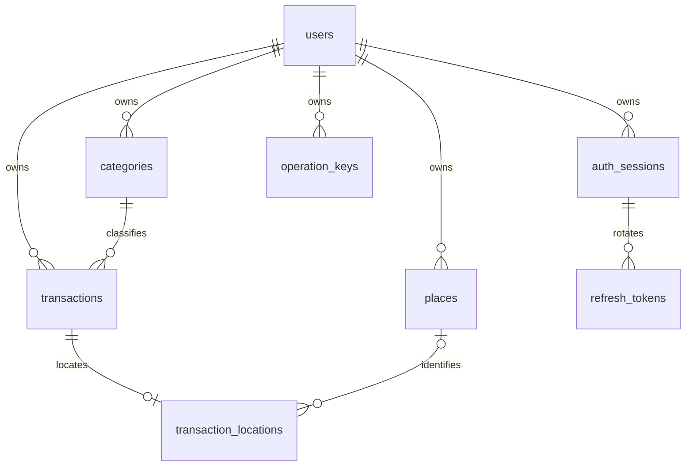

# 데이터 모델

## 1. 공통 정책

architecture.md와 api-spec.md의 명칭을 따른다. SQL 컬럼은 snake_case, JSON은 camelCase다. UUID는 애플리케이션이 생성한다. NN은 NOT NULL, N은 NULL 허용이다. 기본값 '-'는 값이 없어도 된다는 뜻이 아니라 명시 입력해야 함을 뜻한다. 모든 시각은 timestamptz로 UTC 저장, 거래일은 date다. 금액은 bigint이며 API는 정수 문자열이다. 집계 SUM(bigint)는 numeric으로 받아 정밀도를 보존한다.

## 2. users

| 컬럼 | 타입 | Null | 기본값 | 제약/의미 |
|---|---|---|---|---|
| id | uuid | NN | 앱 생성 | PK |
| email | varchar(254) | NN | - | trim 및 lowercase, UNIQUE |
| password_hash | varchar(255) | NN | - | Argon2id encoded |
| display_name | varchar(50) | N | null | trim, 빈 값은 null |
| timezone | varchar(64) | NN | Asia/Seoul | Java ZoneId로 검증 |
| terms_version | varchar(30) | NN | - | 가입 시 동의 버전 |
| terms_accepted_at | timestamptz | NN | now() | 동의 시각 |
| data_revision | bigint | NN | 0 | CHECK >=0, 데이터 변경 시 증가 |
| version | bigint | NN | 0 | 설정 낙관적 잠금 |
| created_at | timestamptz | NN | now() | 생성 |
| updated_at | timestamptz | NN | now() | 서비스가 갱신 |

별도 비활성 운영 기능은 범위 밖이다. 탈퇴하면 행을 삭제하므로 이후 인증은 실패한다. 이메일 문법과 비밀번호 길이는 서비스 검증, email=lower(btrim(email))은 DB CHECK다.

## 3. categories

| 컬럼 | 타입 | Null | 기본값 | 제약/의미 |
|---|---|---|---|---|
| id | uuid | NN | 앱 생성 | PK |
| user_id | uuid | NN | - | users FK CASCADE |
| type | varchar(7) | NN | - | INCOME/EXPENSE CHECK |
| name | varchar(30) | NN | - | trim, 길이 1~30 |
| normalized_name | varchar(30) | NN | - | lower(trim(name)) |
| is_default | boolean | NN | false | 기본 카테고리 수정 금지 |
| archived_at | timestamptz | N | null | 보관 상태 |
| icon | varchar(30) | N | null | 허용 enum 키 |
| color | varchar(7) | N | null | #RRGGBB 검증 |
| sort_order | integer | NN | 0 | 기본 목록 순서 |
| version | bigint | NN | 0 | 낙관적 잠금 |
| created_at | timestamptz | NN | now() | 생성 |
| updated_at | timestamptz | NN | now() | 수정 |

UNIQUE(user_id,type,normalized_name), UNIQUE(user_id,id,type). 이름은 보관 후에도 중복 예약을 유지한다. normalized_name 일치 CHECK를 둔다. 기본 카테고리는 가입 Service에서 사용자별로 복사한다. 보관은 archived_at 갱신이며 하드 삭제 API는 없다. 기본 카테고리와 보관된 카테고리의 수정은 409다. 유형 변경은 불허한다.

## 4. transactions

| 컬럼 | 타입 | Null | 기본값 | 제약/의미 |
|---|---|---|---|---|
| id | uuid | NN | 앱 생성 | PK |
| user_id | uuid | NN | - | users FK CASCADE |
| type | varchar(7) | NN | - | INCOME/EXPENSE |
| amount | bigint | NN | - | 1~999999999999 CHECK |
| currency | char(3) | NN | KRW | currency='KRW' CHECK |
| category_id | uuid | NN | - | 소유자와 유형 복합 FK |
| transaction_date | date | NN | - | 미래 여부 서비스 검증 |
| memo | varchar(500) | N | null | trim, 빈 값 null |
| version | bigint | NN | 0 | If-Match 대응 |
| created_at | timestamptz | NN | now() | 사용자 수정 금지 |
| updated_at | timestamptz | NN | now() | 서비스 갱신 |

UNIQUE(user_id,id). FK(user_id,category_id,type) -> categories(user_id,id,type), ON DELETE NO ACTION DEFERRABLE INITIALLY DEFERRED. 이 제약은 다른 사용자 또는 다른 유형 카테고리 연결을 막고 사용자 탈퇴 cascade가 완료된 시점에 검사한다. 신규 지정은 archived_at=null만 허용한다. 기존 거래 편집에서 동일 보관 category_id를 유지하는 것은 허용한다.

## 5. places

| 컬럼 | 타입 | Null | 기본값 | 제약/의미 |
|---|---|---|---|---|
| id | uuid | NN | 앱 생성 | PK |
| user_id | uuid | NN | - | users FK CASCADE |
| provider | varchar(10) | NN | KAKAO | KAKAO CHECK |
| external_id | varchar(100) | NN | - | 비어 있지 않음 |
| created_at | timestamptz | NN | now() | 생성 |

UNIQUE(user_id,provider,external_id), UNIQUE(user_id,id). 주소 및 이름은 이 테이블에서 갱신하지 않고 각 거래 위치에 저장한다. 장소 목록에 표시할 제목은 해당 필터 내 최신 거래 스냅샷을 사용한다. 사용자가 거래 위치를 바꾸거나 삭제해 참조가 0이 되면 같은 사용자 잠금 Transaction 안에서 고아 Place를 삭제한다. 검색만 하고 취소한 경우 Place를 생성하지 않는다.

## 6. transaction_locations

| 컬럼 | 타입 | Null | 기본값 | 제약/의미 |
|---|---|---|---|---|
| transaction_id | uuid | NN | - | PK, 거래당 최대 한 행 |
| user_id | uuid | NN | - | 거래 소유자 |
| source | varchar(12) | NN | - | CURRENT/SEARCH/MAP |
| place_id | uuid | N | null | 사용자 범위 장소 FK |
| latitude | numeric(9,6) | NN | - | -90~90 CHECK |
| longitude | numeric(9,6) | NN | - | -180~180 CHECK |
| accuracy_m | numeric(12,3) | N | null | >=0 CHECK |
| captured_at | timestamptz | N | null | 현재 위치 획득 시각 |
| low_accuracy_accepted | boolean | NN | false | >1000m 확인 |
| place_name | varchar(200) | N | null | 거래 시점 스냅샷 |
| road_address | varchar(500) | N | null | 도로명 주소 |
| parcel_address | varchar(500) | N | null | 지번 주소 |
| region_code | char(5) | N | null | 숫자 5자리 |
| region_sido | varchar(50) | N | null | 시도 |
| region_sigungu | varchar(100) | N | null | 시군구 |
| region_key | varchar(180) | NN | UNKNOWN | 서버 생성 |

FK(user_id,transaction_id) -> transactions(user_id,id) ON DELETE CASCADE. FK(user_id,place_id) -> places(user_id,id) ON DELETE NO ACTION DEFERRABLE INITIALLY DEFERRED. place_id가 null인 복합 FK는 MATCH SIMPLE이다. 위치 없음은 행 자체가 없으며 NONE source 행을 만들지 않는다.

CHECK: CURRENT이면 accuracy_m 및 captured_at 필수, 다른 출처는 두 필드 null과 low_accuracy_accepted=false. accuracy_m>1000이면 low_accuracy_accepted=true. CURRENT/MAP은 place_id=null. SEARCH는 외부 ID가 없는 경우도 허용하므로 place_id 선택이다. 장소명은 SEARCH일 때 필수다. region_key는 정규 지역 사전에서 확인한 CODE:5자리 또는 UNKNOWN으로 서비스에서 결정하고 클라이언트 값을 받지 않는다. region_key 형식 CHECK와 지역 사전 FK를 적용한다. 원본 region_code와 이름은 스냅샷이므로 정규 키와 단순 문자열 동일 CHECK를 두지 않는다. 주소가 모두 없으면 지역 필드를 null 및 UNKNOWN으로 정규화한다.

좌표 입력은 최대 소수점 6자리 문자열로 받아 넘는 정밀도는 400으로 거부한다. SDK 어댑터가 저장 확인 전에 반올림한 좌표를 미리보기에 사용한다. 좌표 경계에서 반올림 후 범위를 다시 검사한다. 위치 수정은 전체 스냅샷 교체이고 감사 시각은 부모 거래를 사용한다.

## 7. 인증 데이터

### auth_sessions

| 컬럼 | 타입 | Null | 기본값 | 제약 |
|---|---|---|---|---|
| id | uuid | NN | 앱 생성 | PK, JWT sid |
| user_id | uuid | NN | - | users FK CASCADE |
| created_at | timestamptz | NN | now() | 로그인 |
| expires_at | timestamptz | NN | - | 로그인+14일, 생성 이후 CHECK |
| revoked_at | timestamptz | N | null | 폐기 |

### refresh_tokens

| 컬럼 | 타입 | Null | 기본값 | 제약 |
|---|---|---|---|---|
| id | uuid | NN | 앱 생성 | PK |
| session_id | uuid | NN | - | auth_sessions FK CASCADE |
| token_hash | char(64) | NN | - | SHA-256 hex, UNIQUE |
| created_at | timestamptz | NN | now() | 발급 |
| consumed_at | timestamptz | N | null | 회전 사용 완료 |

세션별 활성 토큰 한 개를 partial UNIQUE(session_id) WHERE consumed_at IS NULL로 보장한다. 사용된 해시는 세션 만료 때까지 유지해 재사용을 탐지한다. 만료 세션과 자식은 하루 한 번 삭제한다. 토큰 원문과 개인 위치는 인증 테이블에 없다.

## 8. operation_keys

| 컬럼 | 타입 | Null | 기본값 | 제약 |
|---|---|---|---|---|
| user_id | uuid | NN | - | users FK CASCADE, 복합 PK |
| request_key | uuid | NN | - | 복합 PK, Idempotency-Key |
| body_hash | char(64) | NN | - | 정규화 JSON SHA-256 |
| transaction_id | uuid | NN | - | 생성된 ID, 의도적으로 FK 없음 |
| created_at | timestamptz | NN | now() | 생성 |

PK(user_id,request_key). 성공한 생성과 같은 Transaction으로 저장한다. 거래 삭제 후에도 동일 요청 재시도로 부활시키지 않도록 키와 비식별 거래 ID를 유지한다. 본문 스냅샷을 저장하지 않는다. 사용자 탈퇴 시 삭제한다. 이 행은 Soft Delete 거래나 감사 거래 이력이 아니다.

## 9. 인덱스와 삭제

| 인덱스 | 조회 근거 |
|---|---|
| users(email) UNIQUE | 로그인 및 중복 가입 |
| categories(user_id,type,normalized_name) UNIQUE | 이름 중복 및 소유 범위 |
| categories(user_id,type,sort_order,id) | 선택 목록 |
| transactions(user_id,transaction_date DESC,created_at DESC,id DESC) | 기본 keyset 페이지 |
| transactions(user_id,type,category_id,transaction_date) | 필터 및 통계 |
| transaction_locations(user_id,latitude,longitude) | BBox 초기 후보 축소; 양 좌표 범위의 완전 최적화를 보장하지 않음 |
| transaction_locations(user_id,place_id) | 장소 묶음 및 고아 여부 |
| transaction_locations(user_id,region_key) | 지역 묶음 |
| places(user_id,provider,external_id) UNIQUE | 장소 upsert |
| auth_sessions(user_id), auth_sessions(expires_at) | 탈퇴 및 정리 |
| refresh_tokens(token_hash) UNIQUE, refresh_tokens(session_id) | refresh 조회 및 cascade |

PK와 UNIQUE가 이미 만든 인덱스는 중복 생성하지 않는다. 데이터 10,000건 기준 EXPLAIN ANALYZE로 인덱스 유효성을 검증하고 통계 질의가 full scan을 선택하더라도 측정 없이 추가 인덱스를 늘리지 않는다.

거래 삭제는 위치 cascade, 고아 장소 정리, users.data_revision 증가까지 원자적으로 수행한다. 탈퇴는 사용자 잠금 및 비밀번호 검증 후 users 삭제로 categories, transactions, places, auth_sessions, operation_keys를 제거하고 자식 위치와 refresh_tokens까지 cascade한다. deferred FK는 commit 시 검사한다. 삭제된 UUID만 운영 복원 ledger에 보관하는 절차는 architecture.md를 따른다.

## 10. Flyway 순서

V1__identity_and_categories.sql: users, categories, PK 및 UNIQUE. V2__ledger.sql: region_dictionary, region_aliases를 먼저 생성한 뒤 places, transactions, transaction_locations, 복합 FK와 CHECK. V3__authentication_and_idempotency.sql: auth_sessions, refresh_tokens, operation_keys 및 privacy 스키마와 deletion_ledger. V4__query_indexes.sql: 조회 인덱스. SQL은 이후 구현 단계에서 작성한다.

가입 시 기본 카테고리는 Service가 생성하므로 사용자 UUID가 없는 전역 category seed는 넣지 않는다. 성능 fixture는 test 전용 seed로 분리하고 운영 Flyway에 넣지 않는다. Migration 후 JPA validate, Testcontainers FK 교차 소유권 및 cascade 검증을 실행할 계획이다. 현재 Migration 실행 결과는 미검증이다.

## 11. 교차 검토 추가 데이터 계약

### privacy.deletion_ledger

user_id uuid NN PK, deleted_at timestamptz NN 기본 now(). 사용자 FK는 없다. users 삭제와 같은 Transaction으로 삽입하고 사용자 삭제 cascade 대상에서 제외한다. 개인정보 본문이나 거래 데이터는 저장하지 않는다. 서비스 데이터와 분리한 복원/보존/최신성 조건은 architecture.md 11절을 따른다.

### region_dictionary

region_key varchar(180) NN PK, region_code char(5) NN UNIQUE, sido_name varchar(50) NN, sigungu_name varchar(100) NN, source_version varchar(50) NN. region_key='CODE:' || region_code CHECK 및 숫자 5자리 CHECK. 과거 참조 행은 삭제 금지다. UNKNOWN은 사전 행이 아니라 미분류 표식이다.

### region_aliases

id uuid NN PK, region_key varchar(180) NN FK -> region_dictionary ON DELETE RESTRICT, sido_normalized varchar(50) NN, sigungu_normalized varchar(100) NN, valid_from date NN, valid_to date N. CHECK(valid_to IS NULL OR valid_to>=valid_from). UNIQUE(region_key,sido_normalized,sigungu_normalized,valid_from). 이름 쌍과 유효 기간에 맞는 서로 다른 코드 수가 정확히 1일 때만 매핑한다. 조회 인덱스는 (sido_normalized,sigungu_normalized,valid_from)이다.

transaction_locations에 canonical_region_key varchar(180) N을 추가하고 region_dictionary FK ON DELETE RESTRICT를 둔다. CHECK(region_key=COALESCE(canonical_region_key,'UNKNOWN')). region_key는 계속 API 및 조회용 집계 키다. 이름 기반 원본 region_code=null이어도 canonical_region_key는 채울 수 있다. 원본 스냅샷을 덮어쓰지 않는다. NAME: 접두 집계 키는 사용하지 않는다.

초기 Migration 계획은 V1 사용자/카테고리 -> V2 지역 사전/별칭과 ledger 도메인 테이블 -> V3 인증/멱등성 및 privacy.deletion_ledger -> V4 인덱스다. 아직 실행된 Migration이 없으므로 이 순서로 최초 작성한다. 기존 V2의 places/transactions/transaction_locations보다 지역 사전을 먼저 만든다. 구현 후 적용한 Migration은 수정하지 않고 새 버전을 추가한다.
