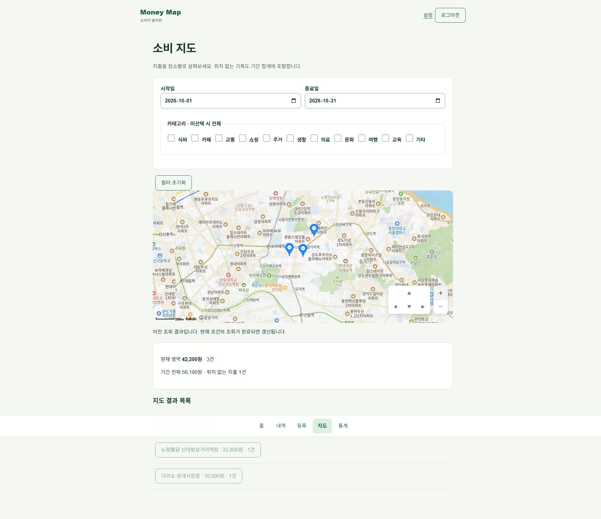
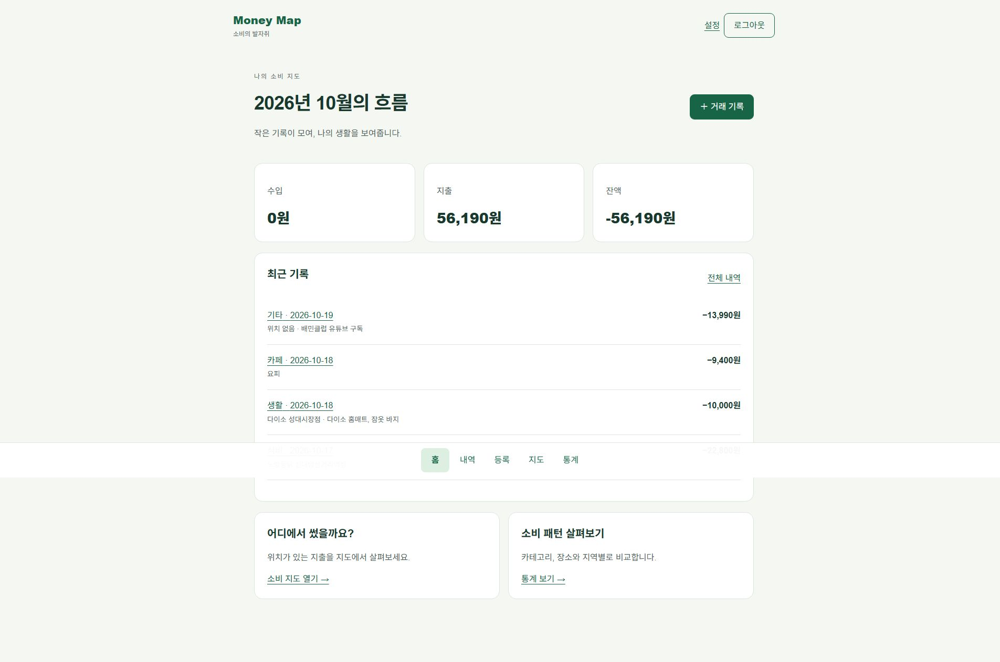
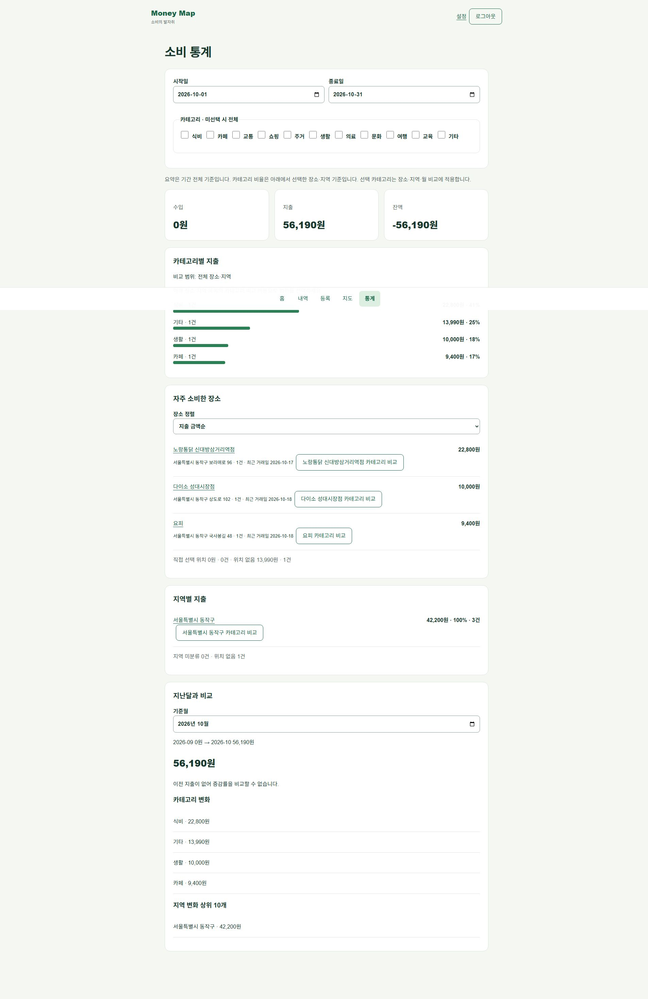

# Money Map - 제품 화면과 운영 개선 사례

기준일: 2026-10-19. 프런트 ea18597 / 백엔드 9f7cb26.

01 / PRODUCT

## Money Map

지출의 금액과 장소를 연결하는 개인 가계부

4년차 풀스택 개발자 / 개인 프로젝트 / AI 코딩 에이전트 협업

소비 지도: 장소별 지출 마커와 지도 이동·배율 조작 패널.

기록을 남기는 데서 끝나지 않고, 어디에서 썼는지 돌아볼 수 있게.

거래에 위치를 선택적으로 저장하고 내역·지도·통계로 연결했습니다. 데스크톱 실사용 중 발견한 입력·상태 관리 문제를 회귀 테스트와 배포 확인까지 이어서 보완했습니다.

- 실제 운영 조회: 지출 4건 / 56,190원. 위치가 있는 지출 3건 42,200원, 위치 없는 지출 1건 13,990원.

- 배포 확인: Vercel: ea18597 배포 성공. 운영 화면에 새 조작 패널 표시. Render readiness: 200 / UP.

- 운영 범위: 개인 실사용을 위한 HTTPS 배포. 거래 기록, 장소 검색, 지도와 통계를 제공하며 공개 회원가입은 제한합니다.

서비스  https://money-map-frontend-murex.vercel.app/
소스  https://github.com/Jimmy0613/money-map

02 / PRODUCT FLOW

## 같은 기록을 세 가지 관점으로

홈에서 흐름을 보고, 내역으로 확인하고, 지도에서 장소를 살펴봅니다.

홈의 월간 요약과 최근 기록 일부. 운영 계정의 실제 화면을 영역 단위로 발췌했습니다.

금액·분류·날짜 거래 입력 → 장소 검색·미리보기 선택적 위치 확정 → 내역·지도·통계 같은 기록 조회

- 위치 있는 기록: 지도에 장소별 지출로 표시합니다. 위치가 있는 지출의 영역 합계와 기간 전체 합계를 구분합니다.

- 위치 없는 기록: 구독 등 장소가 필요 없는 지출도 저장합니다. 지도 마커에서는 제외하고 기간 합계에는 포함합니다.

- 데이터 연결 검증: 홈·내역·통계의 지출 합계 56,190원 일치. 상세 재조회에서 장소명·주소 확인. 수정 화면에서 기존 카테고리 유지 확인.

위치 정보는 선택 사항입니다. 장소가 없는 구독 지출과 장소가 있는 오프라인 소비를 같은 거래 모델로 관리합니다.

03 / ITERATION

## 실사용에서 발견하고 고친 문제

데스크톱 실사용 테스트에서 발견한 현상을 원인·수정·검증으로 연결했습니다.

### A. 장소 검색 Enter가 거래 저장까지 실행

현상: 장소를 고르던 중 상세 화면으로 이동하고 위치가 빠진 거래가 남았습니다. 검색 입력이 거래 폼 안에 있어 Enter의 기본 동작이 거래 제출로 이어질 수 있었습니다.

검색어 입력 + Enter → 기본 폼 제출 차단 → 위치 확정 후 저장 버튼으로 제출

선택: 검색 입력의 Enter 기본 동작만 차단했습니다. 검색은 기존 300ms debounce를 유지하고, 장소 확정과 거래 저장을 별도 단계로 두었습니다.
검증: 검색·확정 중 POST 없음, 명시적 저장 시 선택 장소·좌표 포함. 운영 실사용에서도 위치 저장 성공을 확인했습니다.

### B. 수정 화면의 카테고리가 비어 보임

원인: 폼이 먼저 렌더링되고 카테고리 옵션이 나중에 도착해 기존 값이 선택란에 반영되지 않았습니다. 폼의 categoryId를 구독하고 select의 value와 연결했습니다.

- 재현: 지출·수입·보관 카테고리 3개 시나리오에서 수정 전 테스트가 모두 실패했습니다.

- 회귀 확인: 비동기 목록 도착 후 기존 분류 유지, 메모만 수정해도 원래 categoryId 제출, 목록 재조회 후 사용자 선택 유지.

- 운영 화면: 위치가 있는 기존 거래를 다시 열었을 때 수정 화면에 카페 카테고리가 선택된 상태를 확인했습니다.

### C. 기본 지도를 실제 소비 맥락으로

고정 서울시청 중심 대신 위치가 있는 최근 지출을 조회해 중심을 잡습니다. 거래일 내림차순, 같은 날은 생성 시각·ID 순서를 사용합니다. 지난달 기록이면 해당 월을 보여주고, 다시 진입하면 사용자가 보던 위치를 복원합니다.

변경 커밋  6112c6d / 2cb5b99 / 6538d64 / ea18597
편의성 보완  지도 위 방향·배율 조작 패널, 상세 화면 내역 버튼 우측 정렬, 삭제 버튼의 붉은색 구분.

04 / RELIABILITY

## 응답 유실과 순서 뒤집힘을 다루기

정상 클릭 한 번보다 실패 후에도 데이터와 사용자의 선택이 일치하는지를 확인했습니다.

### 서버: 같은 저장 요청을 식별

모바일 네트워크에서 서버 반영은 성공해도 응답만 사라질 수 있습니다. 버튼을 잠그는 것만으로는 서버 반영 여부를 보장할 수 없어 생성 API에 Idempotency-Key와 정규화한 본문 해시를 사용했습니다.

사용자 행 잠금 → 키·본문 해시 확인 → 거래·위치·작업 키 같은 트랜잭션 저장

- 같은 키·같은 내용: 저장된 기존 거래를 반환합니다.

- 같은 키·다른 내용: 409 충돌로 거부합니다.

- 삭제된 거래의 키: 이미 삭제한 거래를 같은 요청으로 다시 생성하지 않습니다.

대가: 사용자별 쓰기를 직렬화해 판단을 단순하게 만드는 대신, 같은 사용자의 동시 쓰기 처리량에는 제약이 생깁니다.

### 클라이언트: 최신 선택만 반영

검색·현재 위치·주소 변환은 완료 순서가 다릅니다. 검색 순번과 위치 선택 순번을 따로 두고, 응답 시 현재 순번과 비교합니다. 위치를 바꾸거나 해제하면 과거 요청을 무효화합니다.

A 장소 요청 → B 장소로 변경 → 늦게 온 A 응답 현재 순번과 달라 폐기

검증: 역순 검색 응답, 늦은 주소 변환, 위치 해제 뒤 응답, 권한 거부와 시간 초과를 자동 테스트로 다룹니다. 외부 SDK 장애나 위치 오차는 없애지 못하므로 위치 없이 저장하는 경로를 유지합니다.

근거  LedgerService.java / LedgerRepository.java / location-picker.tsx / location-races.test.tsx / test-report.md

05 / ARCHITECTURE

## 서비스 경계를 연결한 배포 구성

브라우저부터 업무 데이터와 외부 지도까지, 각 구간의 책임을 나눴습니다.

브라우저 거래·지도·통계 → Vercel Next.js / API 프록시 → Render Spring Boot / 인증 → Neon PostgreSQL / Flyway

브라우저는 같은 Origin의 API를 호출하고 Next.js가 Render로 전달합니다. Kakao SDK는 장소 검색·지도·주소 변환을 담당하며 어댑터 뒤에 격리했습니다.

- 프런트엔드: Next.js 16 / React 19 / TypeScript. TanStack Query는 서버 상태, React Hook Form은 입력과 검증을 담당합니다.

- 백엔드·데이터: Java 21 / Spring Boot 3.5 / Spring Security / JDBC. PostgreSQL의 트랜잭션·잠금·집계 SQL과 Flyway 이력을 사용합니다.

- 인증·변경 요청: HttpOnly 쿠키, CSRF, Origin 검사, Refresh Token 회전, 사용자 소유권 검사. 수정·삭제는 버전 기반 충돌 검사.

- 연결 분리: 애플리케이션은 pooled DB 연결, Flyway는 direct 연결을 사용합니다.

### 독립된 운영 등록·개방 제어

Cloudflare Worker와 Durable Object는 사용자 DB 밖에 등록 상태·세대를 보관합니다. 메타데이터 관찰 결과와 대상 지문·배포·nonce에 결합된 Ed25519 응답을 백엔드가 검증합니다.

목적은 DB가 교체되거나 복원 상태가 불명확할 때 검증 없이 서비스를 열지 않는 것입니다. 단순 환경변수 개방보다 외부 확인 근거가 추가되지만 매 요청 검증의 지연과 가용성 의존성도 생깁니다.

개인 MVP에서는 복잡도가 큰 선택입니다. 신규 빈 DB의 최초 등록·서명 검증과 실제 전체 WAL 복원 훈련은 구분하며, 후자는 남은 과제입니다.

### 실행 중인 것과 준비된 것을 따로 확인

Render의 Live 표시는 배포 프로세스 성공의 근거입니다. 실제 서비스 준비 여부는 readiness와 Vercel을 경유한 API 응답, 인증 후 화면을 함께 확인합니다.

06 / EVIDENCE

## 검증 결과와 운영 확인

자동 테스트와 실제 운영 화면을 통해 기능별 확인 범위를 기록했습니다.

실제 통계 화면의 요약 영역 발췌. 홈·내역과 같은 지출 합계가 표시됩니다.

- 최신 기능 검사: 프런트 전체 63 PASS: 지도 초기 위치와 카테고리 수정 포함. 최종 UI 변경 후 지도·회귀 28 PASS, 타입·lint 통과.

- 서버 검증 기록: 백엔드 단위·HTTP 53 PASS / PostgreSQL 통합 25 PASS / Worker 정책 5 + 런타임 4 PASS. 서버 배포 시점의 실행 기록 기준.

- 운영 화면 검증: 개인 계정 로그인, 지출 4건 조회, 위치 3곳 지도 표시, 홈·내역·통계 합계 일치, 상세 재조회 및 수정 분류 유지.

- 실사용 검증: 운영 환경에서 거래 등록과 장소 저장을 확인했습니다. 저장된 기록은 홈·내역·지도·통계에서 다시 조회했습니다.

- 배포 근거: ea18597의 Vercel 상태 success / Deployment has completed. 새 지도 조작 패널 표시. Render readiness 200 / UP.

### 검증 범위와 후속 과제

운영에서 등록·조회·위치 저장·수정 화면의 초기값을 확인했습니다. 수정 저장·삭제·응답 유실의 운영 재검증과 다중 기기 검증은 후속 과제로 관리합니다. 자동 테스트와 운영 확인 결과는 환경별로 구분했습니다.

수치는 테스트 사례 수 기준입니다. 성능·사용자 규모·개발 생산성에 대한 별도 정량 평가는 포함하지 않았습니다.

07 / OWNERSHIP & NEXT

## 제품 판단과 검증을 이끈 경험

AI와 협업하며 서비스 범위를 정하고, 실사용 피드백을 개선과 검증으로 연결했습니다.

### 담당 역할: 범위 정의·실사용 검증·개선 요구 구체화

개인 실사용을 목표로 서비스 범위를 정하고 외부 계정·권한 설정과 운영 계정 등록을 진행했습니다. 실제 지출을 등록해 장소 저장과 거래 수정 흐름을 테스트하고, 자동 저장과 카테고리 초기화 결함을 재현 절차로 구체화했습니다.

사용 흐름을 기준으로 최근 소비 위치에서 지도 시작, 상세 버튼의 배치와 삭제 동작의 시각적 구분, 지도 위 조작 패널을 제안했습니다. 기능 유무뿐 아니라 실제 사용 시의 불편을 찾아 개선 우선순위를 정했습니다.

### AI 협업 방식

문서 초안·설계 보완·코드 작성과 원인 분석·자동 테스트 실행에 AI 코딩 에이전트를 활용했습니다. 직접 수행한 제품 요구 정의와 실사용 테스트를 바탕으로 수정 방향을 전달하고, 생성된 결과를 회귀 테스트·운영 화면·배포 상태와 연결했습니다.

### 다음 개선의 우선순위

- 운영 UX: 인증 확인 요청의 시간 제한·재시도와 서버 기동 안내. Render 절전 복귀 시의 대기 현상을 로그·응답 시간과 함께 분석하고 안내 흐름을 보완할 계획입니다.

- 재현 가능한 시연: 개인 기록과 분리한 시연 계정·샘플 데이터, 운영 수정·삭제와 새로고침 유지 검증, 모바일 위치 흐름 재검증.

- 운영 비용·보호: 외부 검증 호출의 지연·장애 비용 관찰, 배포 등록 갱신 절차와 백업·복원 훈련 정리.

### 프로젝트 자료

서비스  https://money-map-frontend-murex.vercel.app/
저장소  https://github.com/Jimmy0613/money-map

검증 문서: test-report.md / bootstrap-deployment.md / evidence.
운영 화면 기준: 2026-10-19, 데스크톱 Chrome. 프런트엔드 ea18597 / 백엔드 9f7cb26.
