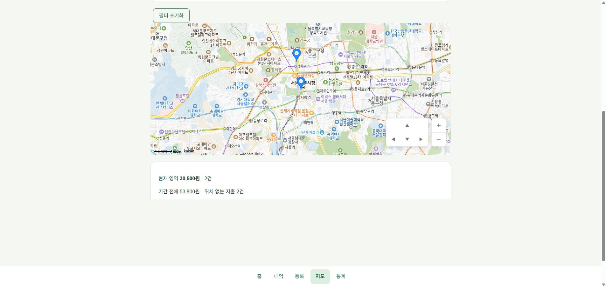
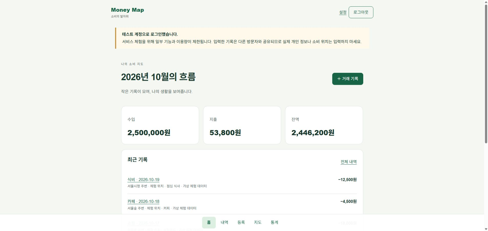
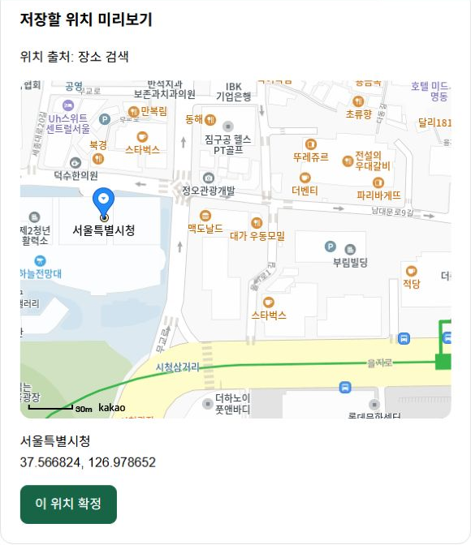
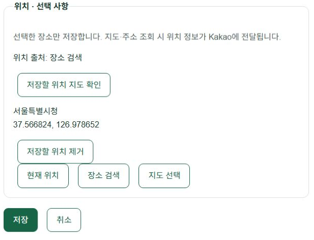
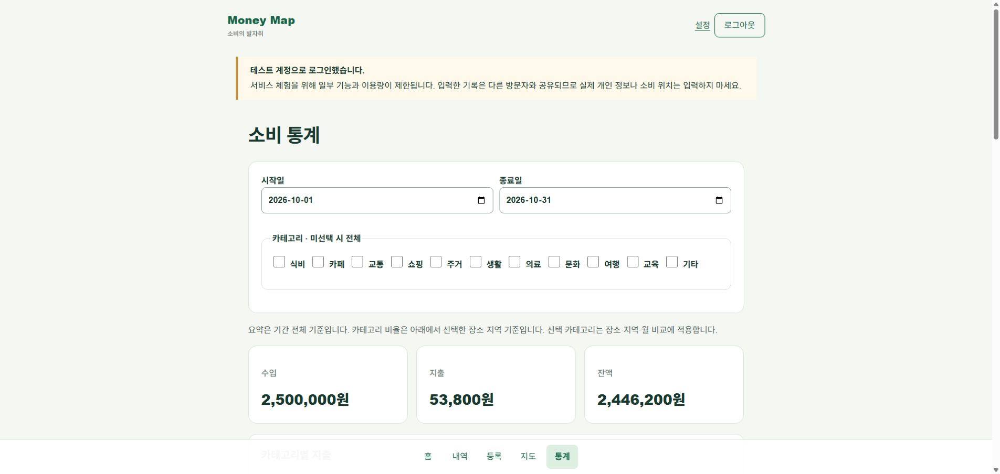

# Money Map - 제품 화면과 운영 개선 사례

개정일: 2026-10-20. JDBC 실행 구성 정리와 통제한 로컬 기동 비교 반영.

01 / PRODUCT

## Money Map

지출의 금액과 장소를 연결하는 개인 가계부

직접 수행  요구 정의·실사용 테스트·개선 방향과 체험 정책 선택
AI 협업  설계 보완·코드 구현·자동 검증 실행

체험 소비 지도: 샘플 지출 위치와 지도 위 이동·배율 조작 패널.

기록을 남기는 데서 끝나지 않고, 어디에서 썼는지 돌아볼 수 있게.

거래에 위치를 선택적으로 저장하고 내역·지도·통계로 연결했습니다. 데스크톱 실사용 중 발견한 입력·상태 관리 문제를 회귀 테스트와 배포 확인까지 이어서 보완했습니다.

- 체험 데이터: 가상 거래 6건. 지출 5건 53,800원 중 위치 있는 지출 3건 35,000원, 위치 없는 지출 2건 18,800원.

- 구현·개선: Next.js / Java 21·Spring Boot / PostgreSQL. 멱등 저장·응답 순서 제어와 JDBC 실행 구성 정리를 검증했습니다.

- 공개 체험: 개인 데이터와 분리한 공용 체험 계정. 입력 기능에 상한을 두고 일반 회원가입과 체험 계정 탈퇴를 차단했습니다.

서비스  https://money-map-frontend-murex.vercel.app/
소스  https://github.com/Jimmy0613/money-map

02 / PRODUCT FLOW

## 같은 기록을 세 가지 관점으로

홈에서 흐름을 보고, 내역으로 확인하고, 지도에서 장소를 살펴봅니다.

가상 샘플로 구성한 체험 홈. 월간 수입·지출·잔액과 최근 기록.

금액·분류·날짜 거래 입력 → 장소 검색·미리보기 선택적 위치 확정 → 내역·지도·통계 같은 기록 조회

- 위치 있는 기록: 지도에 장소별 지출로 표시합니다. 위치가 있는 지출의 영역 합계와 기간 전체 합계를 구분합니다.

- 위치 없는 기록: 구독 등 장소가 필요 없는 지출도 저장합니다. 지도 마커에서는 제외하고 기간 합계에는 포함합니다.

- 데이터 연결 검증: 홈·통계의 지출 53,800원 일치. 운영 임시 거래의 위치·카테고리를 유지한 수정과 삭제까지 확인했습니다.

위치 정보는 선택 사항입니다. 장소가 없는 구독 지출과 장소가 있는 오프라인 소비를 같은 거래 모델로 관리합니다.

03 / ITERATION

## 실사용에서 발견하고 고친 문제

데스크톱 실사용 테스트에서 발견한 현상을 원인·수정·검증으로 연결했습니다.

### A. 장소 검색 Enter가 거래 저장까지 실행

현상: 장소를 고르던 중 상세 화면으로 이동하고 위치가 빠진 거래가 남았습니다. 검색 입력이 거래 폼 안에 있어 Enter의 기본 동작이 거래 제출로 이어질 수 있었습니다.

결과: Enter의 기본 폼 제출을 차단했습니다. 위치 확정 뒤에도 거래 저장은 별도로 실행합니다. 위 화면은 현재 동작을 촬영했으며 수정 전 결함을 재구성하지 않았습니다.

### B. 수정 화면의 카테고리가 비어 보임

원인: 폼이 먼저 렌더링되고 카테고리 옵션이 나중에 도착해 기존 값이 선택란에 반영되지 않았습니다. 폼의 categoryId를 구독하고 select의 value와 연결했습니다.

- 재현: 지출·수입·보관 카테고리 3개 시나리오에서 수정 전 테스트가 모두 실패했습니다.

- 회귀 확인: 비동기 목록 도착 후 기존 분류 유지, 메모만 수정해도 원래 categoryId 제출, 목록 재조회 후 사용자 선택 유지.

- 운영 화면: 위치가 있는 기존 거래를 다시 열었을 때 수정 화면에 기존 식비 카테고리가 선택되고 수정 저장 후에도 유지되는 것을 확인했습니다.

### C. 기본 지도를 실제 소비 맥락으로

고정 서울시청 중심 대신 위치가 있는 최근 지출을 조회해 중심을 잡습니다. 거래일 내림차순, 같은 날은 생성 시각·ID 순서를 사용합니다. 지난달 기록이면 해당 월을 보여주고, 다시 진입하면 사용자가 보던 위치를 복원합니다.

04 / RELIABILITY

## 응답 유실과 순서 뒤집힘을 다루기

정상 클릭 한 번보다 실패 후에도 데이터와 사용자의 선택이 일치하는지를 확인했습니다.

### 서버: 같은 저장 요청을 식별

모바일 네트워크에서 서버 반영은 성공해도 응답만 사라질 수 있습니다. 버튼을 잠그는 것만으로는 서버 반영 여부를 보장할 수 없어 생성 API에 Idempotency-Key와 정규화한 본문 해시를 사용했습니다.

사용자 행 잠금 → 키·본문 해시 확인 → 거래·위치·작업 키 같은 트랜잭션 저장

- 같은 키·같은 내용: 저장된 기존 거래를 반환합니다.

- 같은 키·다른 내용: 409 충돌로 거부합니다.

- 삭제된 거래의 키: 이미 삭제한 거래를 같은 요청으로 다시 생성하지 않습니다.

대가: 사용자별 쓰기를 직렬화해 판단을 단순하게 만드는 대신, 같은 사용자의 동시 쓰기 처리량에는 제약이 생깁니다.

### 클라이언트: 최신 선택만 반영

검색·현재 위치·주소 변환은 완료 순서가 다릅니다. 검색 순번과 위치 선택 순번을 따로 두고, 응답 시 현재 순번과 비교합니다. 위치를 바꾸거나 해제하면 과거 요청을 무효화합니다.

입력 화면 → SDK: A 요청, B 요청 / SDK → 화면: B 반영, 늦은 A 폐기

검증: 역순 검색 응답, 늦은 주소 변환, 위치 해제 뒤 응답, 권한 거부와 시간 초과를 자동 테스트로 다룹니다. 외부 SDK 장애나 위치 오차는 없애지 못하므로 위치 없이 저장하는 경로를 유지합니다.

근거  LedgerService.java / LedgerRepository.java / location-picker.tsx / location-races.test.tsx / test-report.md

05 / ARCHITECTURE

## 서비스 경계를 연결한 배포 구성

브라우저부터 업무 데이터와 외부 지도까지, 각 구간의 책임을 나눴습니다.

브라우저 → Vercel → Render → Neon / 브라우저 → Kakao / Render → Worker → Durable Object → Neon 메타데이터 관찰

브라우저는 같은 Origin의 API를 호출하고 Next.js가 Render로 전달합니다. Kakao SDK는 장소 검색·지도·주소 변환을 담당하며 어댑터 뒤에 격리했습니다.

- 프런트엔드: Next.js 16 / React 19 / TypeScript. TanStack Query는 서버 상태, React Hook Form은 입력과 검증을 담당합니다.

- 백엔드·데이터: Java 21 / Spring Boot 3.5 / Spring Security / JDBC. PostgreSQL의 트랜잭션·잠금·집계 SQL과 Flyway 이력을 사용합니다.

- 인증·변경 요청: HttpOnly 쿠키, CSRF, Origin 검사, Refresh Token 회전, 사용자 소유권 검사. 수정·삭제는 버전 기반 충돌 검사.

- 연결 분리: 애플리케이션은 pooled DB 연결, Flyway는 direct 연결을 사용합니다.

### 독립된 운영 등록·개방 제어

복원·교체 상태가 불명확한 DB를 검증 없이 사용하지 않기 위한 독립 등록입니다. 요청별 서명 증거를 확인하는 대신 지연·외부 장애 의존성이 생깁니다. 개인 MVP에는 복잡도가 큰 선택으로, 상세 계약은 저장소 문서로 분리했습니다.

### 실행 중인 것과 준비된 것을 따로 확인

Render의 Live 표시는 배포 프로세스 성공의 근거입니다. 실제 서비스 준비 여부는 readiness와 Vercel을 경유한 API 응답, 인증 후 화면을 함께 확인합니다.

06 / STARTUP & OPERATIONS

## 느린 첫 접속의 원인을 좁히기

무료 서버의 절전과 애플리케이션 초기화 비용을 구분했습니다.

### 관찰: JDBC 서비스에서 JPA도 초기화

서버 로그에는 JPA Repository가 0개인데 EntityManagerFactory 초기화가 나타났습니다. 업무 코드를 확인하니 거래·인증·조회는 JDBC였고 엔티티 1개가 시작 시 스키마 검증을 맡고 있었습니다.

실제 참조·설정 조사 → JDBC 실행 구성으로 정리 → 동일 조건 교차 측정

### 선택: 검증을 유지하면서 ORM 제거

JPA starter·미사용 엔티티·전용 설정을 제거하고 JDBC starter로 교체했습니다. Flyway 이후 거래 테이블의 필수 컬럼·타입을 확인하는 JDBC 검증을 두어 누락·변경 시 기동을 거부합니다. 트랜잭션과 잠금의 회귀 테스트도 실행했습니다.

- 준비 완료 시간: 로컬 중앙값 4.997초 → 4.185초, 약 16.2% 감소. 각각 예열 후 3회, 순서를 교차해 측정했습니다.

- 실행 파일: JAR 69.99MB → 40.67MB, 약 41.9% 감소. 내부 라이브러리 74개 → 54개. JPA 초기화 로그도 사라졌습니다.

- 측정 조건: 동일 Windows·Java 21.0.4·로컬 PostgreSQL. JVM 최대 힙 192MB와 다른 메모리 상한도 동일하게 유지했습니다.

이 결과는 깨어 있는 로컬 DB 기준입니다. Render의 CPU·절전 복귀, Neon 최초 연결, 외부 서명 검증 지연을 포함하지 않으므로 운영 시작 시간이 같은 비율로 줄었다고 해석하지 않습니다.

### 공개 체험의 범위와 운영 제약

개인 기록과 분리한 가상 샘플·공용 체험 계정을 제공하고 가입·탈퇴를 제한했습니다. 저장·인증 상한과 서버 요청 예산을 두되, 조회와 외부 호출까지 막는 비용 상한으로 보지는 않았습니다. 첫 연결 안내·60초 제한·재연결을 제공하며 저장 응답 유실 시 내역 확인을 안내합니다.

근거  startup-review-2026-10-20.md / evidence/startup-jdbc-2026-10-20.json

07 / EVIDENCE

## 검증을 환경과 근거로 구분하기

자동 테스트, 실제 DB, 운영 화면을 각각 확인했습니다.

2026년 10월 체험 통계. 수입 2,500,000원 / 지출 53,800원 / 잔액 2,446,200원.

- 프런트엔드: 66개 테스트 통과. 타입·lint·프로덕션 빌드 확인. 장소 선택 경쟁 상태, 수정 분류 유지와 연결 복구를 다룹니다.

- 백엔드: 단위·HTTP·대기 용량 69개. 실제 DB 통합 19개와 컨테이너 재시작 11개로 멱등 저장·세션 철회·JDBC 롤백·스키마 거부를 확인했습니다.

- 외부 검증 서버: Worker 정책 6개·런타임 10개 통과. 별도 Neon DB와 Worker에서 등록 갱신·서명·재실행 거부·차단 보존 검증.

- 운영 기능: 체험 거래 등록, Enter 검색, 장소 확정, 위치 저장, 카테고리·위치 보존 수정, 승인된 임시 거래 삭제 및 통계 합계를 확인했습니다.

- 운영 배포: 8c250df 배포 Live·readiness 200 확인. 기존 데이터·키를 보존하고 등록 세대를 5로 갱신했습니다. 일반 가입은 계속 차단합니다.

### 가용성 개선 사례: 동시 조회의 검증 대기

지도·통계가 여러 조회를 동시에 보낼 때 안전 검증이 간헐적으로 실패했습니다. 동시 실행 8개를 유지하며 최대 3초 대기하도록 바꾸고, 연결 제한을 검증 시간 예산 안에서 조정했습니다. 새 서명·nonce 검사는 그대로 유지했습니다.

개선 후 소규모 동시 요청 10건 모두 200 응답을 확인했습니다. 최종 이미지 배포 후에도 5건 모두 성공했습니다. 이 수치는 부하 시험이나 대규모 처리 성능을 의미하지 않습니다.

08 / OWNERSHIP & NEXT

## 제품 판단과 검증을 이끈 경험

AI 협업 결과를 실제 사용 흐름과 운영 근거로 검토했습니다.

### 담당 역할: 요구 정의·실사용 테스트·개선 우선순위

개인 가계부의 범위를 정하고 실제 사용 중 발견한 자동 저장·카테고리 초기화 결함을 재현 절차로 구체화했습니다. 최근 소비 위치에서 지도 시작, 버튼 배치와 시각적 구분 등 사용성 개선 방향을 정했습니다.

URL 공개 전에는 개인 계정과 체험 데이터의 분리, 입력 기능의 체험 범위, 데이터·인증 상한과 가입 차단을 선택했습니다. 기능 성공뿐 아니라 오작동·자원 소진·다른 방문자의 체험 방해까지 고려하는 방향으로 범위를 확장했습니다.

### AI 협업 방식과 검토 기준

설계 보완·코드 작성·원인 분석·문서 초안·자동 테스트 실행에 AI 코딩 에이전트를 활용했습니다. 직접 수행한 요구 정의와 실사용 테스트를 바탕으로 수정 방향을 전달하고, 결과를 테스트·코드·운영 화면·배포 상태로 대조했습니다.

보안 권고는 설치 버전과 실제 노출 조건을 구분하고, 테스트 결과는 환경별로 기록했습니다. 개인 계정과 운영 인프라의 인증 정보는 공개 체험 계정과 분리해 관리합니다.

### 남은 개선 과제

- 제3자·모바일 검증: 제3자 사용성 테스트와 모바일·다중 기기 흐름 검증. 현재 자동 테스트와 데스크톱 운영 확인을 대체하지 않는 후속 단계입니다.

- 운영 자동화: 통합 사용량·오류 감시, 체험 데이터 수명과 관리자 복구 절차. 누적 한도는 자동 초기화되지 않으며 무료 서비스의 가용성도 보장하지 않습니다.

- 복원·의존성 유지: 전체 WAL 복원 훈련, 남은 조건부 권고의 수정판·기능 도입 시 재검토. 배포 등록 갱신 검증과 전체 재해 복구 완료는 구분합니다.

### 직접 확인할 수 있는 자료

서비스  https://money-map-frontend-murex.vercel.app/
저장소  https://github.com/Jimmy0613/money-map

체험 이메일  demo@money-map.example  /  비밀번호  demo1q2w3e4r5%

공유 체험 계정입니다. 실제 개인정보 입력을 피하고, 일부 기능·이용량 제한을 확인해주세요.

Spring 조건부 권고 2건과 Flyway의 PostgreSQL 18 지원 경고가 남아 있습니다. 상세 조건·검사 결과는 저장소 문서를 따릅니다.
