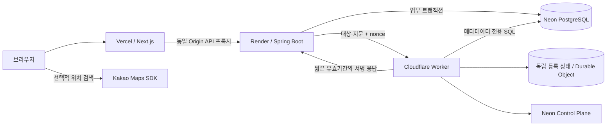

# Money Map
## AI와 함께 요구사항에서 배포까지 완성한 풀스택 개인 프로젝트

**4년차 풀스택 개발자 | 개인 프로젝트 | AI 코딩 에이전트 활용 | 2026.10.19 기준**

> 지출에 선택적으로 위치를 연결하는 가계부를 만들고, 실제 HTTPS 환경에 배포해 본인 계정 로그인까지 확인했습니다. 자연어로 기능을 요청하는 데서 멈추지 않고, 요구사항·API 계약·구현·테스트·배포 기록을 연결해 AI가 만든 결과를 검증하는 과정을 경험했습니다.

- 서비스: https://money-map-frontend-murex.vercel.app/
- 저장소: https://github.com/Jimmy0613/money-map
- 운영 범위: 개인 계정 사용. 공개 회원가입은 닫혀 있습니다.
- 배포 기준 커밋: `9f7cb26`.

### 이 프로젝트에서 보여주고 싶은 역량

프런트엔드 화면, 백엔드 API, 데이터 일관성, 인증, 외부 지도 SDK, 배포 환경을 하나의 서비스 흐름으로 연결했습니다. AI의 코드 생성 능력을 활용하되, 완료 여부는 실제 실행 결과와 확인 가능한 근거로 판단하는 개발 방식을 적용했습니다.

여기서 ‘바이브 코딩’은 AI에 자연어로 의도를 전달하고 결과를 반복 보완하는 방식을 뜻합니다. 구현 코드를 모두 직접 작성했다고 주장하기보다, **AI와 협업해 개발 범위를 구체화하고 실행 가능한 서비스로 연결한 과정**을 보여주는 프로젝트입니다.

---

## 1. 어떤 서비스를 만들었나

금액과 카테고리만으로는 소비를 돌아볼 때 장소의 맥락이 빠집니다. Money Map은 거래에 위치를 선택적으로 남기고, 내역·지도·통계에서 같은 소비 기록을 다른 관점으로 볼 수 있도록 구성했습니다. 이는 프로젝트의 문제 가설이며, 사용자 조사로 검증한 시장 수요나 사업 성과를 의미하지는 않습니다.

핵심 사용 흐름은 **로그인 → 거래 입력 → 선택적 위치 지정 → 내역·지도·통계 확인**입니다. 위치 권한 거부나 지도 SDK 장애가 기본 거래 기록을 막지 않도록 위치 없는 저장 경로도 제공합니다.

| 영역 | 구현 내용 |
|---|---|
| 계정 | 가입·로그인·로그아웃, 세션 확인, Refresh Token 회전, 계정 삭제 |
| 거래 | KRW 수입·지출 등록/조회/수정/삭제, 카테고리, 날짜, 메모 |
| 위치 | 현재 위치·장소 검색·지도 선택, 주소 미리보기, 위치 없이 저장 |
| 지도 | 기간·카테고리·영역에 따른 지출 조회, 마커·결과 목록·상세 연결 |
| 통계 | 요약, 카테고리·장소·지역 순위, 월 비교 |
| 사용성 | 모바일 대응, 로딩·빈 결과·오류 상태, 재시도와 입력 보존 |

**구현 여부와 모든 환경에서의 검증 완료 여부는 구분합니다.** 배포 후 본인 로그인은 확인했으며, 본인이 입력한 첫 운영 거래의 저장·새로고침 검증은 진행하지 않았습니다.

## 2. 기술과 배포 구성

| 구간 | 사용 기술 | 선택·적용 의도 |
|---|---|---|
| 프런트엔드 | Next.js 16, React 19, TypeScript | 화면·라우팅과 API 프록시 구성 |
| 상태·폼 | TanStack Query, React Hook Form, Zod | 서버 상태와 폼 검증 책임 분리 |
| 백엔드 | Java 21, Spring Boot 3.5, Spring Security | 인증·업무 규칙·트랜잭션 경계 구성 |
| 데이터 접근 | Spring JDBC, PostgreSQL, Flyway | 집계 SQL과 잠금·마이그레이션 명시 |
| 위치 서비스 | Kakao Maps JavaScript SDK | 검색·좌표·주소 변환을 어댑터로 분리 |
| 검증 | JUnit, Testcontainers, Vitest, Testing Library, Playwright | 단위·DB·브라우저 검증 구분 |
| 배포 | Vercel, Render Docker, Neon PostgreSQL | 프런트·Java 서버·DB의 실행 특성에 맞춰 분리 |
| 개방 제어 | Cloudflare Worker, SQLite Durable Object, Ed25519 | 사용자 DB와 분리된 최초 운영 등록·서명 검증 |

로컬 PostgreSQL 통합 테스트 기준은 17.6이며 실제 Neon은 18.6입니다. 실행은 검증했지만 Flyway의 지원 버전 경고가 있어, 두 환경의 완전한 호환성을 인증한 것으로 표현하지 않습니다.

브라우저는 Vercel의 같은 Origin으로 API를 호출하고, Next.js 프록시가 Render에 전달합니다. 인증 토큰은 HttpOnly 쿠키로 관리하고, 변경 요청에는 CSRF 토큰과 정확한 Origin 검사를 적용했습니다. 애플리케이션 DB 연결에는 pooled URL, Flyway에는 direct URL을 사용합니다.

## 3. AI 협업을 어떻게 진행했나

단계별 프롬프트와 승인 문서를 출발점으로 사용했습니다. 요구사항, 아키텍처, ERD, API 계약, 구현 체크리스트와 테스트 매트릭스를 구현 전후에 다시 읽게 하여, 대화의 기억에만 의존하지 않도록 했습니다.

| 단계 | 진행 방식 | 남긴 근거 |
|---|---|---|
| 범위 정의 | 필수·선택 기능과 승인된 기본값을 문서로 고정 | requirements, change-log |
| 설계 | 데이터 제약·API 오류·실패 복구·보안 경계 정의 | architecture, ERD, API spec |
| 환경 준비 | macOS·Java·Node·Docker 및 샌드박스 제한 확인 | environment-check |
| 구현 | 계약과 체크리스트를 기준으로 코드 생성·수정 | 코드, Flyway, 구현 체크리스트 |
| 자체 점검 | 문서와 코드를 대조해 누락 원인 확인·보완 | requirements-review, acceptance-criteria |
| 검증 | Mock·실제 DB·브라우저·실기기 결과 구분 | test-report, evidence |
| 배포 | 실제 계정·환경변수·도메인 연결과 HTTPS 확인 | deployment-plan, 배포 증거 |

### 사람과 AI의 역할을 구분했다

사용자는 서비스 방향과 사용 범위를 정하고 승인 사항을 전달했으며, 외부 계정 로그인·권한 승인·실기기 확인·본인 계정 등록을 수행했습니다. AI 코딩 에이전트는 문서 초안과 설계 보완, 코드 작성, 테스트 실행, 결함 탐색, 배포 도구 구성 등을 수행했습니다. 요구사항과 구현을 재대조하도록 요청하고 발견된 미구현 항목의 보완을 이어간 것도 이 과정에 포함됩니다.

이 프로젝트는 **AI에 맡길 작업을 실행 가능한 단위로 나누고, 생성 결과를 계약·테스트·배포 결과와 연결한 경험**을 보여줍니다. AI와의 협업 범위를 공개하고 결과의 추적 가능성을 확보했습니다. 개별 기술 판단의 설명 근거는 실제 코드와 문서에 두었습니다.

## 4. 문제 해결 사례 A: 저장 응답이 유실돼도 거래가 중복되지 않게

### 문제와 판단

모바일 네트워크에서 저장 요청은 서버에 반영됐지만 응답만 유실될 수 있습니다. 이때 사용자가 재시도하면 같은 지출이 두 번 기록될 수 있습니다. 버튼 비활성화만으로는 서버 반영 여부를 알 수 없어, API와 DB에서 같은 작업을 식별하도록 했습니다.

### 구현

거래 생성에 `Idempotency-Key`를 요구하고, 사용자별 작업 키와 정규화한 요청 본문의 해시를 기록합니다. 사용자 행 잠금 후 기존 작업을 확인하고 거래·위치·작업 키를 하나의 트랜잭션으로 저장합니다.

| 재요청 조건 | 처리 |
|---|---|
| 같은 키 + 같은 내용 | 기존 거래 반환 |
| 같은 키 + 다른 내용 | 409 충돌 |
| 이미 삭제된 거래의 작업 키 | 재생성하지 않고 거부 |

수정·삭제에는 버전 기반 충돌 검사를 적용하고, 오래된 목록 커서는 revision 비교로 다시 조회하도록 했습니다. 이는 무조건 재시도하는 UI보다 서버의 처리 결과를 확인하는 흐름을 우선한 선택입니다.

### 확인 범위와 대가

실제 PostgreSQL 통합 검사와 이전 실제 브라우저 응답 유실 시나리오 기록을 근거로 삼았습니다. 사용자 행 잠금은 사용자별 쓰기 순서를 단순하게 만드는 대신, 같은 사용자의 동시 쓰기를 직렬화합니다. 대규모 쓰기 처리량에 최적화됐다고 주장하지 않습니다.

근거: `LedgerService.java`, `LedgerRepository.java`, `frontend/src/shared/api.ts`, `test-report.md`.

## 5. 문제 해결 사례 B: 늦은 위치 응답이 최신 선택을 덮어쓰는 문제

### 문제와 판단

장소 검색·현재 위치·주소 변환은 비동기로 완료됩니다. 사용자가 다른 장소를 선택하거나 위치를 해제한 뒤 이전 요청이 늦게 끝나면, 이미 버린 좌표나 주소가 다시 나타날 수 있습니다. 검색 성능만의 문제가 아니라 사용자의 현재 선택을 보존해야 하는 상태 관리 문제로 다뤘습니다.

### 구현

검색과 위치 선택에 각각 요청 순번을 두고, 응답을 반영할 때 현재 순번과 비교합니다. 검색은 300ms debounce를 적용하고, 위치 변경·해제 시 이전 선택 요청을 무효화합니다. 저장할 좌표·주소는 확정 전에 미리보기로 보여주며 위치 없음 경로를 유지했습니다.

### 확인 범위와 대가

Frontend 테스트에는 역순 검색 응답, 주소 변환 지연, 위치 선택·해제 관련 시나리오가 있습니다. 이전 실기기 확인에서는 위치 있는 금액·주소 저장과 지도 마커 표시, 권한 거부 이후 위치 없는 저장을 사용자와 확인했습니다. 이 과거 결과를 현재 운영 배포의 모든 모바일 환경 재검증으로 확장하지는 않습니다.

어댑터와 요청 순번은 화면 상태의 일관성을 다루지만, 외부 SDK 장애나 위치 오차 자체를 없애지는 않습니다. 사용자가 실패 상태를 이해하고 위치 없이 계속할 수 있게 만드는 것도 구현 범위에 포함했습니다.

근거: `frontend/src/features/location-picker.tsx`, `location-races.test.tsx`, `location-picker.test.tsx`.

## 6. 문제 해결 사례 C: 서버가 켜진 것과 서비스가 준비된 것을 구분

### 문제와 판단

무료 호스팅을 연결하는 과정에서 로그인 화면은 열리지만 API는 차단된 상태를 만났습니다. 기존 복원 보호 설계가 외부 검증 증거를 요구했기 때문입니다. 기존 보호 요구를 유지하며 신규 빈 DB를 정당하게 처음 등록하는 경로를 별도로 만들었습니다.

### 구현

Cloudflare Durable Object에 사용자 DB와 분리된 운영 등록 상태·세대를 저장했습니다. 최초 등록에서는 빈 DB와 복원·reset 이력 부재를 확인하고, 이후 요청에서는 Neon의 provider 메타데이터와 SQL 관찰 결과를 등록 정보와 대조합니다. 개인정보 테이블을 읽을 수 없는 검증 전용 DB 역할을 사용합니다.

Backend는 대상 지문·환경·배포·매 요청 nonce에 결합된 Ed25519 응답과 짧은 유효기간을 검사합니다. 실패하거나 대상이 바뀌면 차단합니다. 일반적인 compute 기동 중 상태와 복원·계보 불일치를 구분했고, Render의 실제 배포 commit과 등록된 배포도 대조했습니다.

### 운영에서 확인한 결과

| 확인한 대상 | 결과 |
|---|---|
| Render liveness / readiness | 실제 HTTPS 200 |
| Vercel → Render CSRF API | 실제 HTTPS 200 |
| 공개 회원가입 | 허용 이메일도 403으로 거부 |
| 본인 계정 등록 | 사용자 1명·기본 카테고리 16개 생성 확인 |
| 본인 HTTPS 로그인 | 사용자 완료 안내 + 인증 후 대시보드 확인 |

### 이 선택의 한계

개인 MVP에는 외부 검증 호출과 운영 복잡도가 추가되는 선택입니다. 이 프로젝트에서는 이미 승인된 복원 차단 요구를 유지하기 위해 적용했으며, 모든 가계부 서비스에 필요한 일반 해법이라고 보지는 않습니다. 최초 운영 등록을 구현한 것이 실제 WAL 복원·백업 보존·전체 재해 복구를 완성했다는 뜻도 아닙니다. 배포·스키마 변경의 등록 갱신 절차도 추가 보완이 필요합니다.

근거: `bootstrap-deployment.md`, `RecoveryGate.java`, `infra/recovery-authority/src/`, 실제 배포 증거.

## 7. 무엇을 검증했나

| 검증 층위 | 확인한 결과 | 해석 범위 |
|---|---|---|
| Backend 단위·HTTP | 53 PASS | 최종 서버 빌드의 자동 검사 |
| PostgreSQL 통합 | 25 PASS | Testcontainers의 실제 DB 검사 |
| Worker 정책·런타임 | 5 + 4 PASS | 결합·서명 및 SQLite 상태·eviction·장애 검사 |
| 실제 Neon·Cloudflare | 최초 등록·서명·잘못된 대상 거부 | 격리 환경 및 별도 운영 등록 확인 |
| 운영 프로필 E2E | 합성 가입·로그인·갱신·탈퇴 | local 우회 없는 격리 DB + 실제 외부 권위 서버 |
| 프런트 | 생산 빌드 성공 | 실제 `npm run build` 결과 |
| 실제 공개 배포 | 상태 점검·API 연결·본인 로그인 | 운영 거래 저장 완료와는 구분 |

숫자는 테스트 사례 수이며 기능 수나 요구사항 수락률이 아닙니다. 과거 Frontend 55 PASS와 성능 측정 기록도 저장소에 있으나, 현재 배포 환경에서 모두 다시 실행한 수치로 합산하지 않았습니다. 운영 권위 서버 왕복이 추가된 현재 성능을 과거 로컬 부하 수치로 설명하지 않습니다.

## 8. 현재 한계와 다음 개선

첫 목표는 공개 SaaS 전체 출시가 아니라 **무료 서비스 계정을 활용한 개인 배포와 본인 로그인**이었습니다. 현재 본인용 운영 계정이 있고 공개 회원가입은 닫혀 있습니다. 포트폴리오 시연 전용 계정은 아직 별도로 준비하지 않았습니다.

다음 우선순위는 실제 운영 거래 저장·재조회 확인, 현재 배포 기준 모바일 위치 흐름 재검증, 개인 데이터와 분리된 시연 계정/샘플 데이터, 배포 등록 갱신 절차 정리입니다. 이후 운영 백업·복원 훈련, 무료 호스팅 콜드스타트와 외부 검증 호출 비용·지연 관찰, 브라우저·접근성 검증 범위를 확장할 계획입니다. 이 목록은 완료된 성과가 아니라 후속 작업입니다.

## 9. 이 경험에서 얻은 것

AI를 활용하면 화면과 API의 첫 구현을 빠르게 확보할 수 있지만, 문서 간 불일치나 검증되지 않은 성공 판단도 함께 누적될 수 있습니다. 이 프로젝트에서는 요구사항을 다시 읽고 구현과 대조하는 점검, 실패 시나리오, 실제 배포 확인을 별도 단계로 유지했습니다.

4년차 풀스택 개발자로서 강조하고 싶은 것은 도구 사용 자체보다 **프런트·백엔드·데이터·운영 사이의 경계를 연결하고, AI의 결과를 확인 가능한 서비스 상태로 바꾼 경험**입니다. 동시에 개인 MVP에 추가한 제어 계층의 복잡성과 미완료 운영 과제를 설명할 수 있도록, 적용 이유와 한계도 남겼습니다.

### 면접에서 설명할 60초 소개

“Money Map은 소비에 위치를 선택적으로 연결하는 가계부입니다. AI 코딩 에이전트와 함께 요구사항·설계·구현·테스트를 진행하고 Next.js, Spring Boot, PostgreSQL을 실제 HTTPS 환경에 배포했습니다. 핵심 사례는 응답 유실 시 중복 거래를 막는 멱등성 처리, 오래된 위치 응답을 버리는 프런트 상태 관리, 신규 운영 DB를 별도로 검증해 개방한 배포 과정입니다. AI의 코드 작성을 활용하면서 문서와 테스트·실행 증거로 결과를 확인한 과정을 보여주고 싶습니다. 현재는 본인 계정 로그인까지 확인했고, 운영 거래 저장과 전체 복원 검증은 완료 범위와 구분하고 있습니다.”

---

## 근거 문서와 공개 시 주의 범위

최신 상태는 `deployment-plan.md`와 `evidence/production-personal-login-confirmed.json`을 기준으로 했습니다. README와 일부 설계 문서의 과거 시점 문구를 현재 상태로 그대로 인용하지 않았습니다. 요구사항·설계·자체 점검·테스트 보고서는 프로젝트 진행 이력입니다.

공개 포트폴리오에는 Secret, 개인 이메일, 계정 비밀번호, DB 연결 문자열, 정밀 위치 및 개인 거래 내역을 포함하지 않습니다. 서비스 링크는 로그인 화면 확인용이며, 별도 시연 계정이 없는 현재 상태에서 비밀번호를 공개하지 않습니다. 프로젝트 기간·절감 시간·사용자 수·팀 성과·업무 경력은 근거가 없는 숫자로 보완하지 않았습니다.
